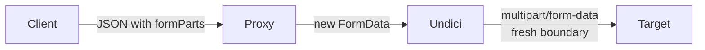

# Doc Studio — API reference

The only network-facing surface Doc Studio ships is the optional
CORS-bypass proxy at `/__proxy`. This document is the contract for
that endpoint plus the wire formats for saved requests, exports, and
persisted objects.

**Index**

1. [`/__proxy` — HTTP contract](#1-__proxy--http-contract)
2. [Request body schema](#2-request-body-schema)
3. [Response body schema](#3-response-body-schema)
4. [Error taxonomy](#4-error-taxonomy)
5. [Headers policy](#5-headers-policy)
6. [Multipart transport](#6-multipart-transport)
7. [Insecure-TLS policy](#7-insecure-tls-policy)
8. [SSRF policy](#8-ssrf-policy)
9. [Size limits](#9-size-limits)
10. [Curl envelope format](#10-curl-envelope-format)
11. [Rendered preview format](#11-rendered-preview-format)
12. [Standalone HTML export format](#12-standalone-html-export-format)
13. [Client SDK — `proxyClient`](#13-client-sdk--proxyclient)
14. [Sample interactions](#14-sample-interactions)

---

## 1. `/__proxy` — HTTP contract

| Method | Path | Body | Purpose |
|--------|------|------|---------|
| `GET`  | `/__proxy` | — | Availability probe. Returns `400 {ok:false, needsPost:true}` — the client uses receipt of any JSON body as "proxy is here" |
| `POST` | `/__proxy?url=<absolute URL>` | JSON — see §2 | Perform an outbound request on behalf of the client |
| `GET`  | `/healthz` | — | Liveness probe (server host only, not dev) |

Mounted by both:

- The Vite dev server via [vite-plugins/dev-proxy.ts](../vite-plugins/dev-proxy.ts).
- The Node host via [server/index.ts](../server/index.ts).

Both entry points share the same `handleProxy(req, res)` — behaviour
is identical in dev and prod.

---

## 2. Request body schema

```ts
interface ProxyRequestBody {
  method?: 'GET'|'POST'|'PUT'|'PATCH'|'DELETE'|'HEAD'|'OPTIONS';
  headers?: Array<{ name: string; value: string }>;
  body?: string;                    // raw text body
  insecure?: boolean;               // TLS: accept self-signed
  allowPrivate?: boolean;           // opt out of SSRF blocklist
  formParts?: SerialisedFormPart[]; // if set, `body` is ignored
}

interface SerialisedFormPart {
  name: string;
  kind: 'text' | 'file';
  value?: string;             // for kind='text'
  filename?: string;          // for kind='file'
  contentType?: string;       // for kind='file'
  base64?: string;            // for kind='file'
}
```

**Rules**

- `?url=` query param carries the target URL. It must be absolute
  (`https?://…`). The proxy calls `new URL(url)` — malformed URLs
  return `400`.
- If `formParts` is present and non-empty, `body` is ignored — the
  proxy rebuilds a fresh `FormData` with a new boundary.
- `headers` is an array of `{name,value}` pairs (not a map) to
  preserve duplicate headers and case-preserving order.
- `allowPrivate` defaults to `false`. See [§8](#8-ssrf-policy).

---

## 3. Response body schema

Successful proxy responses are always `200` with `content-type:
application/json`:

```ts
interface ProxyResponseBody {
  ok: true;
  status: number;
  statusText: string;
  contentType: string | null;
  finalUrl: string;                     // after redirects
  contentDisposition: string | null;
  headers: Array<{ name: string; value: string }>;
  // exactly one of these two:
  text?: string;
  binaryBase64?: string;
  // client hints from mimeExt.resolveResponseFormat
  isBinary?: boolean;
  byteSize?: number;
}
```

The proxy chooses `text` vs `binaryBase64` by:

1. If the target's `content-type` matches a text-like MIME (see
   [`isBinaryMime`](../src/lib/mimeExt.ts) inverted), decode as UTF-8
   and return `text`.
2. Otherwise, base64-encode the bytes and return `binaryBase64`.

---

## 4. Error taxonomy

Error responses use `4xx` / `5xx` status codes with a JSON body:

```ts
interface ProxyErrorBody {
  ok: false;
  reason:
    | 'needsPost'          // GET on /__proxy — probe response
    | 'missing-url'        // ?url= absent or empty
    | 'invalid-url'        // URL parse failed
    | 'blocked-host'       // isBlockedHost hit and allowPrivate=false
    | 'request-too-large'  // body over MAX_REQUEST_BODY
    | 'response-too-large' // stream exceeded MAX_BYTES
    | 'malformed-body'     // JSON parse failed
    | 'upstream-error';    // undici fetch threw
  message: string;         // human-readable
  cause?: string;          // flattened err.cause chain
  code?: string;           // undici error code where available
}
```

| Status | Typical reason |
|--------|----------------|
| `400`  | `needsPost`, `missing-url`, `invalid-url`, `malformed-body` |
| `403`  | `blocked-host` |
| `413`  | `request-too-large`, `response-too-large` |
| `502`  | `upstream-error` |

---

## 5. Headers policy

Sent to the target:

- Every header from `headers[]` is forwarded verbatim.
- The proxy does **not** inject `Host`, `Origin`, `Referer`, or auth
  headers; it forwards whatever the client provides.
- Node adds `Accept-Encoding: gzip, deflate` unless overridden.

Received from the target:

- Response headers are echoed back inside `headers[]` (minus
  hop-by-hop headers like `connection`, `keep-alive`,
  `proxy-authenticate`, `transfer-encoding`).
- `content-type`, `content-disposition`, and `finalUrl` (post-redirect)
  are hoisted to top-level fields for convenience.

---

## 6. Multipart transport

Because `multipart/form-data` isn't representable in JSON, files are
transported as base64 inside `formParts[]`. The proxy reconstructs a
`FormData` server-side:



**Reason.** Undici generates a fresh boundary on `FormData.set`; the
client can't safely predict it, and re-encoding on both sides
guarantees the wire form is well-formed.

**Cost.** Base64 adds ~33% to the wire size. `MAX_REQUEST_BODY = 8 MB`
therefore caps attachments at roughly 5.5 MB of raw file bytes.

---

## 7. Insecure-TLS policy

Setting `insecure: true` on a request instructs the proxy to accept
self-signed certificates. Implementation:

```ts
let insecureAgent: UndiciAgent | null = null;
function getInsecureAgent(): UndiciAgent {
  insecureAgent ??= new UndiciAgent({ connect: { rejectUnauthorized: false } });
  return insecureAgent;
}
```

Properties:

- The `Agent` is a memoised singleton — one for the process lifetime.
- Undici pools sockets per-dispatcher, so a shared instance is
  cheaper than a per-request agent.
- Global TLS defaults are **never** mutated. Concurrent secure
  requests keep validating certificates normally.

---

## 8. SSRF policy

`isBlockedHost(hostname)` (in
[dev-proxy.ts](../vite-plugins/dev-proxy.ts)) matches:

| Pattern | Covers |
|---------|--------|
| `^127\.` | Loopback IPv4 |
| `^0\.0\.0\.0$` | Wildcard |
| `^10\.` | RFC1918 |
| `^192\.168\.` | RFC1918 |
| `^169\.254\.` | Link-local (AWS/GCP metadata) |
| `^172\.(1[6-9]\|2\d\|3[0-1])\.` | RFC1918 |
| `^::1$` | Loopback IPv6 |
| `^fc[0-9a-f][0-9a-f]:` | Unique-local IPv6 |
| `^fe80:` | Link-local IPv6 |

Behaviour:

- Blocked host + `allowPrivate: false` → `403 blocked-host`.
- Blocked host + `allowPrivate: true` → allowed, at the user's risk.
- Non-blocked hosts → always allowed.

`proxyClient` on the client side auto-sets `allowPrivate: true` when
`isPrivateHost(url.hostname)` returns true — so the user's intranet
dev servers "just work" without a per-request toggle.

---

## 9. Size limits

| Constant | Value | Where enforced |
|----------|-------|----------------|
| `MAX_REQUEST_BODY` | 8 MB | `readJsonBody` (proxy) — 413 |
| `MAX_BYTES` | 16 MB | undici stream (proxy) — 413 truncation notice |
| `MAX_INLINE_IMAGE_BYTES` | 3 MB | `archive.ts` — larger images become download-only |
| `MAX_TEXT_PRELOAD_BYTES` | 1 MB | `archive.ts` — larger text loads on click |
| `MAX_DOCX_RENDER_BYTES` | 8 MB | `archive.ts` — larger DOCX skip mammoth |

---

## 10. Curl envelope format

Saved request+response envelopes stored as collection entries with
`language: 'json'`:

```jsonc
{
  "kind": "doc-studio/curl-request",
  "request": {
    "url": "https://api.example.com/v1/foo",
    "method": "POST",
    "headers": [
      { "name": "Authorization", "value": "Bearer …" },
      { "name": "Content-Type",  "value": "application/json" }
    ],
    "body": "{\"foo\":42}",
    "insecure": false,
    "formParts": []
  },
  "response": {
    "status": 200,
    "statusText": "OK",
    "contentType": "application/json",
    "finalUrl": "https://api.example.com/v1/foo",
    "contentDisposition": null,
    "text": "{\"ok\":true}",
    "isBinary": false,
    "byteSize": 11
  }
}
```

**Envelope classification.**
[`CurlRequestPreview.looksLikeCurlEnvelope`](../src/components/Preview/CurlRequestPreview.tsx)
does a fast substring probe (`"doc-studio/curl-request"`); only if it
hits does the component run the full JSON parse.

**Compatibility.** Only `kind` and `request` are required; older
envelopes without `response` still open — they simply have no
response viewer.

---

## 11. Rendered preview format

For container archives (`docx`, `xlsx`, `pptx`, `tex`), the archive is
extended with a **synthetic entry**:

- `path`: `RENDERED_PREVIEW_PATH = '(rendered preview).md'`
- `size`: byte length of the markdown
- `language`: `'markdown'`
- `content`: the Markdown produced by the corresponding converter
- `isRendered`: `true`

The archive's `primaryPath` is set to `RENDERED_PREVIEW_PATH` so the
sidebar opens it first when the user clicks the archive. The raw
entries remain browsable underneath.

---

## 12. Standalone HTML export format

`buildStandaloneHtml(body, title, {embedCss})` produces:

```html
<!doctype html>
<html lang="en">
  <head>
    <meta charset="utf-8" />
    <meta name="viewport" content="width=device-width, initial-scale=1" />
    <title><!-- escaped title --></title>
    <style><!-- EMBEDDED_CSS when embedCss:true --></style>
  </head>
  <body><!-- injected bodyHtml verbatim --></body>
</html>
```

The `EMBEDDED_CSS` constant (see
[mdToHtml.ts](../src/lib/converters/mdToHtml.ts)) is a
print-friendly reset with typography rules matching the on-screen
preview and additional rules for `figure.mermaid-block` so exported
Mermaid diagrams remain centred and printable.

**"clean" mode** (`embedCss: false`) returns the same wrapper without
the `<style>` block, so consumers can drop the body into a CMS with
their own styles.

**"embedded" mode** (in the ExportDialog) is a distinct mode from
`clean` — it inlines the currently rendered preview root **including**
its runtime-applied CSS custom properties (LaTeX style knobs, dark-mode
inversions), so the export renders exactly like the user sees it.

---

## 13. Client SDK — `proxyClient`

```ts
// isProxyAvailable — cached probe; returns boolean.
async function isProxyAvailable(): Promise<boolean>;

// Fire-and-forget request, choosing proxy or direct automatically.
async function fetchViaProxyOrDirect(
  url: string,
  opts?: {
    method?: string;
    headers?: Array<{ name: string; value: string }>;
    body?: string;
    insecure?: boolean;
    allowPrivate?: boolean;
    formParts?: FormPart[];
  },
): Promise<ProxyResult>;

// Convenience for pre-parsed cURL.
async function fetchFromCurl(parsed: ParsedCurl): Promise<ProxyResult>;

interface ProxyResult {
  viaProxy: boolean;      // false = direct browser fetch
  status: number;
  statusText: string;
  contentType: string | null;
  finalUrl: string;
  contentDisposition: string | null;
  headers: Array<{ name: string; value: string }>;
  text?: string;
  binaryBase64?: string;
  byteSize: number;
  isBinary: boolean;
}
```

**Contract guarantees**

- **Automatic proxy selection.** First call probes `/__proxy`; result
  is cached for the session.
- **Auto `allowPrivate`.** If the target hostname matches
  `isPrivateHost`, the client submits `allowPrivate: true` — matching
  user intent when they explicitly hit an intranet URL.
- **Deterministic base64 encoding.** `arrayBufferToBase64` is
  stack-safe via 32 KiB chunks.
- **Never throws for HTTP status errors.** Only network / parse
  failures throw. Callers should inspect `.status`.

---

## 14. Sample interactions

### 14.1 Simple GET

Client → proxy:
```
POST /__proxy?url=https%3A%2F%2Fapi.example.com%2Fping HTTP/1.1
content-type: application/json

{"method":"GET","headers":[]}
```

Proxy → client:
```
HTTP/1.1 200 OK
content-type: application/json

{"ok":true,"status":200,"statusText":"OK",
 "contentType":"application/json","finalUrl":"https://api.example.com/ping",
 "contentDisposition":null,"headers":[…],"text":"{\"pong\":true}",
 "isBinary":false,"byteSize":13}
```

### 14.2 POST JSON with auth

```json
{
  "method": "POST",
  "headers": [
    {"name":"Authorization","value":"Bearer eyJhbGciOi…"},
    {"name":"Content-Type","value":"application/json"}
  ],
  "body": "{\"query\":\"…\"}"
}
```

### 14.3 Multipart upload

```json
{
  "method": "POST",
  "headers": [],
  "formParts": [
    {"name":"description","kind":"text","value":"June report"},
    {"name":"file","kind":"file","filename":"report.pdf",
     "contentType":"application/pdf","base64":"JVBERi0xLj…"}
  ]
}
```

### 14.4 SSRF block

Client:
```json
{"method":"GET","headers":[]}
```
URL: `?url=http://169.254.169.254/latest/meta-data/`

Proxy → client:
```json
HTTP/1.1 403 Forbidden

{"ok":false,"reason":"blocked-host",
 "message":"host 169.254.169.254 is in the SSRF blocklist. Pass allowPrivate:true to override."}
```

### 14.5 Response too large

Target sends 200 MB stream. Proxy stops at `MAX_BYTES`:
```json
HTTP/1.1 413 Payload Too Large

{"ok":false,"reason":"response-too-large",
 "message":"response exceeded 16777216 bytes; truncated"}
```
