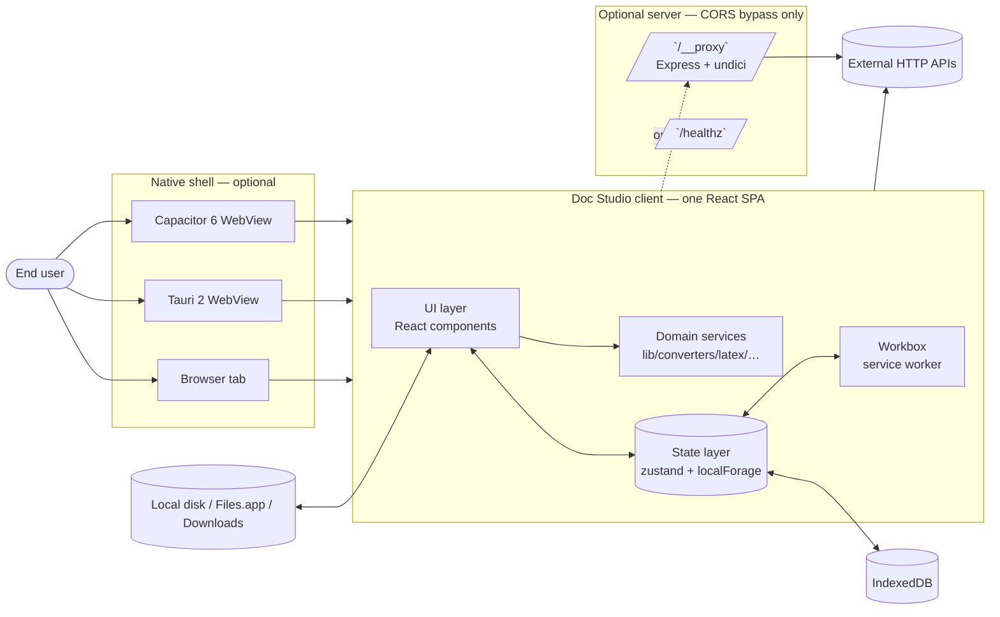
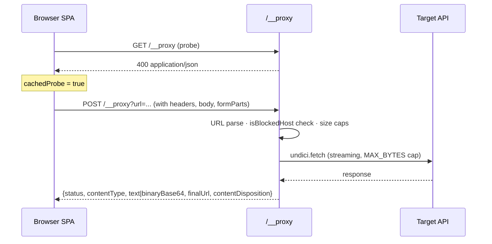
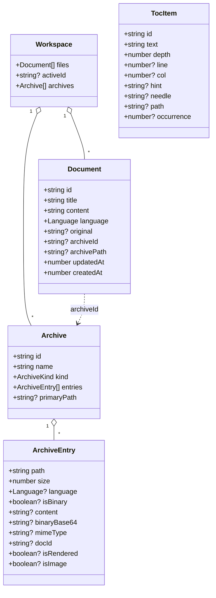
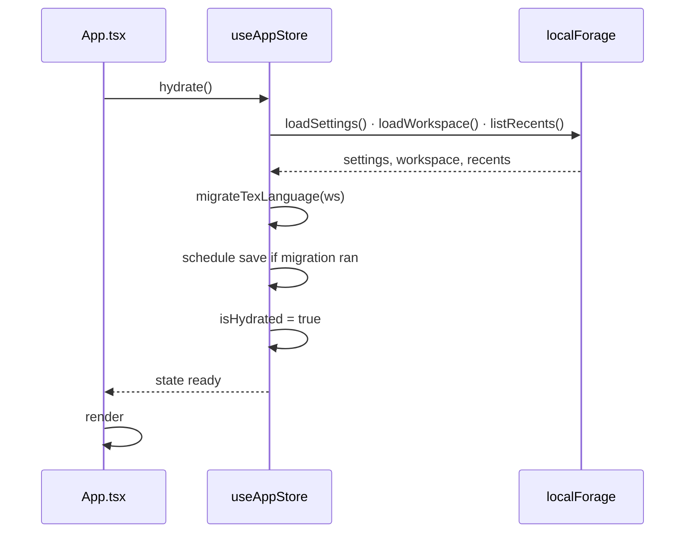
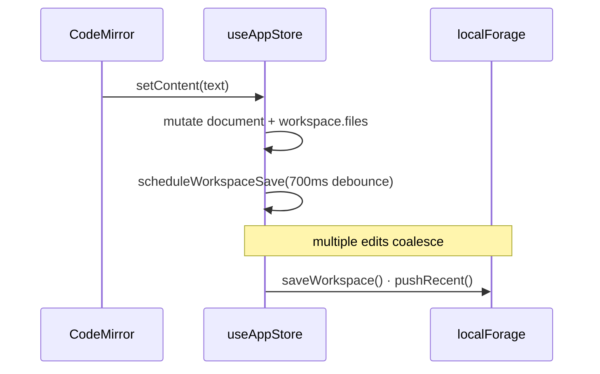
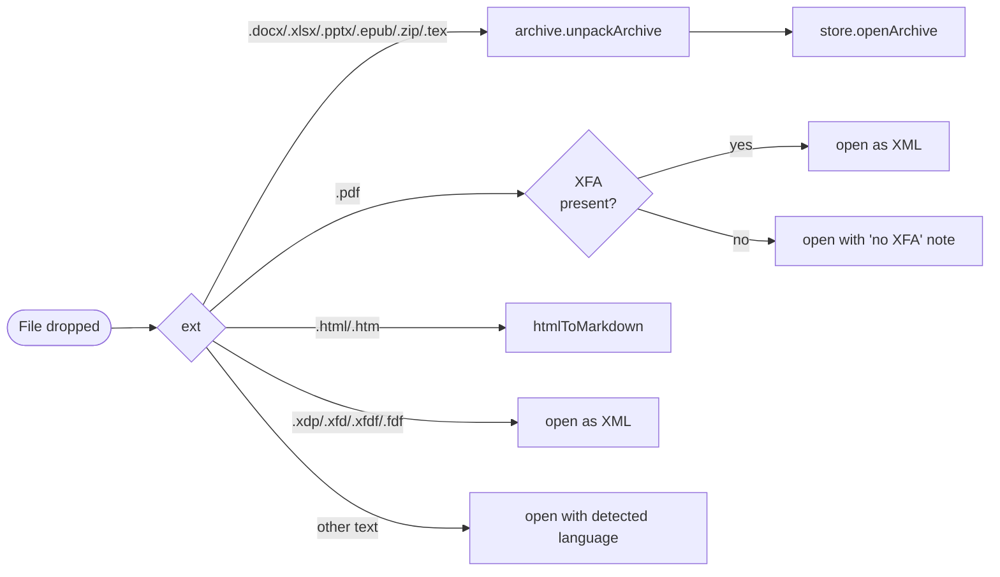
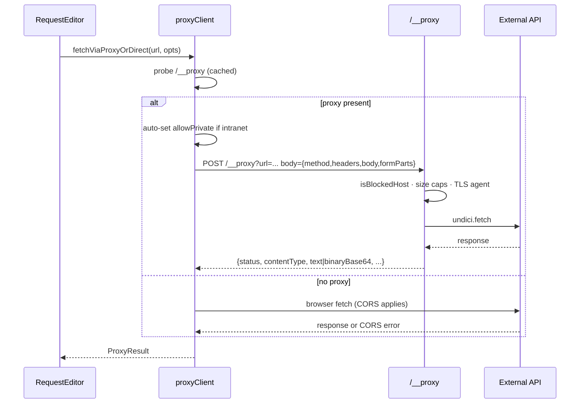
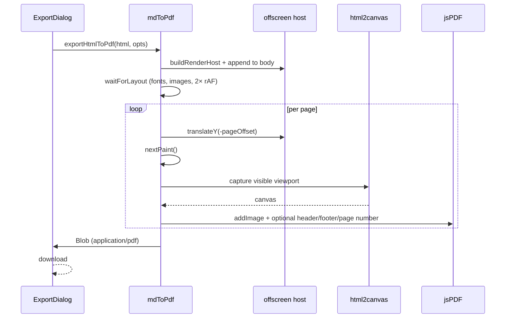
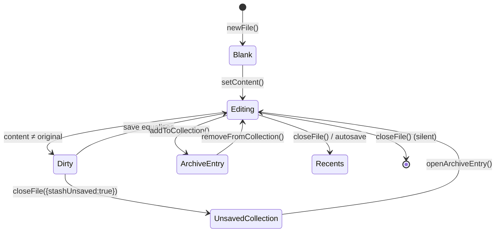
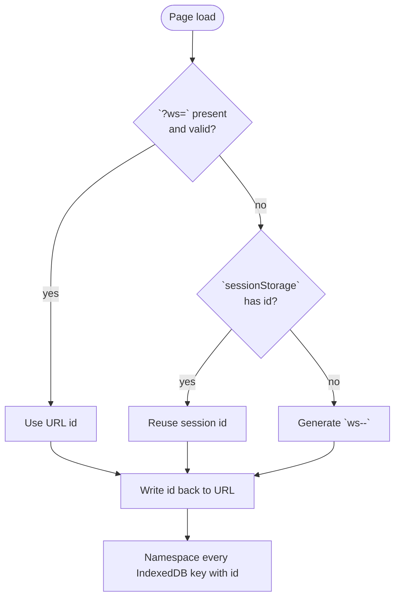

# Doc Studio — High-Level Design (HLD)

| | |
|---|---|
| **Product** | Doc Studio — client-first document + API workbench |
| **Document** | High-Level Design (HLD) |
| **Status** | Living — updated alongside code |
| **Audience** | Architects, senior engineers, platform stakeholders, security reviewers, anyone onboarding |
| **Companions** | [LLD.md](LLD.md) — module-by-module internals · [TDD.md](TDD.md) — scenarios, contracts, rationale |

---

## Table of contents

1. [Product vision & scope](#1-product-vision--scope)
2. [Target users & personas](#2-target-users--personas)
3. [Feature capability matrix](#3-feature-capability-matrix)
4. [System context diagram](#4-system-context-diagram)
5. [Framework & technology stack](#5-framework--technology-stack)
6. [Architectural layers](#6-architectural-layers)
7. [Delivery channels & deployment topology](#7-delivery-channels--deployment-topology)
8. [Core data model](#8-core-data-model)
9. [Runtime flows (high level)](#9-runtime-flows-high-level)
10. [State ownership & lifecycle](#10-state-ownership--lifecycle)
11. [Cross-cutting concerns](#11-cross-cutting-concerns)
12. [Non-functional requirements](#12-non-functional-requirements)
13. [Architectural decisions (ADR summary)](#13-architectural-decisions-adr-summary)
14. [Boundaries and non-goals](#14-boundaries-and-non-goals)
15. [Glossary](#15-glossary)

---

## 1. Product vision & scope

Doc Studio is a **browser-first, offline-capable document and API
workbench** that unifies three normally-separate tool categories into a
single installable PWA:

| Category | Traditional tool | Doc Studio equivalent |
|----------|------------------|-----------------------|
| Rich-text authoring | VS Code + Typora + Word | Multi-format editor (Markdown / HTML / JSON / XML / XFA-XDP / LaTeX-as-Markdown) with live preview, Mermaid, KaTeX, LaTeX rendering, PDF export |
| Archive & document inspection | 7-zip + Word + Preview | In-app unpacker for `.docx`, `.xlsx`, `.pptx`, `.epub`, `.zip`, `.tex`; browsable tree; per-entry preview + rendered synthesis |
| API workbench | Postman + Insomnia + curl | cURL / URL / raw-request import; Postman-style runner with auth, multipart uploads, response viewer; save into collections |

The unifying primitive is the **Document** — any input (file upload,
paste, drag-drop, cURL response, archive entry) becomes a `Document`
and flows through the same editor → preview → export pipeline.

**Distinctive product traits**

- **Client-first.** Full feature set works offline in a static bundle.
  No account, no telemetry, no server round-trip for editing, previewing,
  converting, or exporting.
- **Six delivery channels from one bundle.** PWA, single-file HTML,
  Docker, Tauri desktop (Windows / macOS / Linux), Capacitor Android,
  Capacitor iOS.
- **Multi-workspace isolation** via a URL parameter (`?ws=<id>`) —
  multiple installed instances of the same PWA maintain independent
  IndexedDB partitions.
- **Optional dev/prod HTTP proxy** (`/__proxy`) for CORS-locked API
  targets, with SSRF guards, size caps, and per-request TLS overrides.

---

## 2. Target users & personas

The design centres on four personas. Every feature can be traced back to
at least one of them.

### 2.1 Diane — the document producer

Writes technical reports, résumés, and one-pagers in Markdown or
LaTeX. Needs:

- Live preview with Mermaid, KaTeX, syntax-highlighted code.
- Reliable PDF export with page numbers, header, footer.
- Style knobs to tune LaTeX output without editing CSS by hand.
- Offline capability (works on a plane).

### 2.2 Alex — the API tinkerer

Copies cURL from browser devtools or a Postman collection to test an
API. Needs:

- Paste-in-place cURL parsing with headers, body, auth, multipart parts.
- Send the request through a proxy when CORS blocks direct fetch.
- Response viewer that surfaces the right MIME (JSON / XML / HTML / PDF
  / binary) and lets him save the request AND response into a
  collection for later replay.

### 2.3 Priya — the archive spelunker

Handed a `.docx` / `.xlsx` / dynamic PDF and needs to see the XML,
diff a template, or extract a snippet. Needs:

- Drag-and-drop unpack of container formats.
- Browsable tree of every entry with size hints and MIME detection.
- Preview per entry (XML, images, rendered Markdown of DOCX body).
- Re-export the modified archive.

### 2.4 Sam — the mobile / offline user

Wants the same app on a phone or in a coffee shop without Wi-Fi. Needs:

- Installable on iOS / Android from a URL, no store.
- Single-file variant (`dist-single/index.html`) that AirDrops between
  devices and runs from `Files.app`.
- Local storage of all documents (IndexedDB), survives reboot.

---

## 3. Feature capability matrix

| Capability | PWA | Single-file HTML | Docker | Tauri desktop | Capacitor Android | Capacitor iOS |
|-----------|-----|------------------|--------|---------------|-------------------|---------------|
| Multi-format editor | ✅ | ✅ | ✅ | ✅ | ✅ | ✅ |
| Live Markdown / HTML / LaTeX preview | ✅ | ✅ | ✅ | ✅ | ✅ | ✅ |
| Mermaid + KaTeX rendering | ✅ | ✅ | ✅ | ✅ | ✅ | ✅ |
| PDF export | ✅ | ✅ | ✅ | ✅ | ✅ | ✅ |
| Archive unpack (docx / xlsx / pptx / epub / zip / tex) | ✅ | ✅ | ✅ | ✅ | ✅ | ✅ |
| XFA / XDP extraction from dynamic PDFs | ✅ | ✅ | ✅ | ✅ | ✅ | ✅ |
| Multi-workspace isolation (`?ws=<id>`) | ✅ | ⚠️ file-based | ✅ | ✅ | ✅ | ✅ |
| Autosave to IndexedDB | ✅ | ✅ | ✅ | ✅ | ✅ | ✅ |
| Offline (service worker) | ✅ | n/a | ✅ | ✅ | ✅ | ✅ |
| Installable | ✅ | ⚠️ file distribution | n/a | ✅ | ✅ | ✅ |
| cURL / URL import (direct fetch, subject to CORS) | ✅ | ✅ | ✅ | ✅ | ✅ | ✅ |
| CORS-bypass proxy (`/__proxy`) | ⚠️ needs host | ❌ | ✅ | ❌ | ❌ | ❌ |
| Multipart file uploads via proxy | ⚠️ needs host | ❌ | ✅ | ❌ | ❌ | ❌ |

Legend: ✅ full · ⚠️ conditional · ❌ not applicable.

---

## 4. System context diagram



**External touchpoints**

| Touchpoint | Direction | Protocol | Notes |
|-----------|-----------|----------|-------|
| Local disk | in / out | File / Blob API | Drag-drop, file picker, download |
| IndexedDB | in / out | localForage | Per-workspace namespace |
| External HTTP APIs (direct) | in / out | fetch | Subject to CORS |
| External HTTP APIs (via proxy) | in / out | fetch → Express → undici | SSRF-guarded, size-capped, insecure-TLS opt-in |
| Service worker cache | read | Cache API | Managed by Workbox |
| OS `prefers-color-scheme` | read | MediaQuery | For theme = 'system' |

---

## 5. Framework & technology stack

### 5.1 Core stack

| Layer | Tech | Version | Why |
|-------|------|---------|-----|
| Language | TypeScript | 5.6 | Strict typing over React + zustand; catches the `Language` / `Document` invariants that hold state consistent |
| UI framework | React | 18.3 | Concurrent rendering primitives (`useDeferredValue`, `useTransition`) for preview throttling; largest editor-ecosystem gravity |
| Bundler | Vite | 5.4 | Fastest ESM dev HMR; expressive plugin surface (`configureServer`, `resolveId`, `load`) accommodates latex.js's dynamic-require quirks |
| Styling | TailwindCSS + `@tailwindcss/typography` | 3.4 | Utility-first; JIT keeps CSS payload proportional to what's used |
| Animation | framer-motion | 11 | Modal transitions, toast entry/exit, sidebar slide |
| State management | zustand | 4 | Action-centric store matches how the app mutates state; no provider tree; selector-based subscriptions play well with Fast Refresh |
| Persistence | localForage | 1.10 | Async IndexedDB with localStorage fallback; identical API across every browser and Tauri WebView |
| Icons | lucide-react | 0.454 | Consistent line-icon vocabulary; tree-shakeable per-icon imports |

### 5.2 Editor + rendering stack

| Concern | Tech | Notes |
|---------|------|-------|
| Code editor | CodeMirror 6 (`@codemirror/*`) | Modular; each language is a separate ~20-40 KB package that we lazy-split |
| Markdown pipeline | `react-markdown` + `remark-gfm` + `remark-emoji` + `remark-math` + `rehype-highlight` + `rehype-slug` + `rehype-raw` + `rehype-katex` | Composable AST plugins; each independently swappable |
| Syntax highlighter | highlight.js | Bundled via rehype-highlight |
| Diagrams | mermaid 11 | Lazy-loaded (~667 KB gz); registers per-diagram via unique-id + hash |
| Math | KaTeX | Preferred over MathJax for smaller footprint and faster render |
| LaTeX | latex.js 0.12.6 | Real PEG-based parser + HTML5 generator; lazy-loaded (~576 KB); patched at postinstall to remove `.keep` markers that break esbuild's glob scan |
| PDF export | jsPDF + html2canvas | Per-page canvas capture (avoids 32k-pixel canvas limit); overlays native PDF text for header / footer / page numbers |

### 5.3 Import / conversion stack

| Format | Library | Direction |
|--------|---------|-----------|
| DOCX | mammoth (UMD, injected as `<script>`) | .docx → HTML → Markdown |
| PPTX | JSZip + `DOMParser` | Slide XML → per-slide Markdown |
| XLSX | JSZip + `DOMParser` | Sheet XML → GFM tables |
| HTML | turndown + turndown-plugin-gfm | HTML → Markdown |
| LaTeX | Hand-written regex converter (`texToMd.ts`) | .tex → Markdown preview |
| JSON ↔ XML | Hand-written recursive walkers (`jsonXml.ts`) | Bidirectional |
| PDF → XFA | Native `DecompressionStream` + regex scan | Raw + FlateDecode stream scan |
| Container archives | JSZip | Unpack + repack |

### 5.4 Server & proxy stack

| Concern | Tech |
|---------|------|
| HTTP framework | Express 4 |
| Outbound fetch | undici v8 (per-request `Agent` for TLS overrides) |
| Static hosting | `express.static` with immutable long-cache headers on hashed assets |

### 5.5 Native shells

| Channel | Shell | Native lang |
|---------|-------|-------------|
| Desktop | Tauri 2 | Rust |
| Mobile | Capacitor 6 | Java / Kotlin (Android), Swift / Objective-C (iOS) |

### 5.6 Build & tooling

| Concern | Tech |
|---------|------|
| PWA + service worker | vite-plugin-pwa + Workbox |
| Single-file bundle | vite-plugin-singlefile |
| Icon rasterisation | @resvg/resvg-js (`scripts/gen-icons.ts`) |
| Testing | Vitest 4 (separate config so tests don't drag in PWA plugin) |
| Linting | ESLint + `@typescript-eslint` |
| CI | GitHub Actions — four workflows (web+docker, tauri, android, ios) |

---

## 6. Architectural layers

The client is a four-layer stack; each layer knows only about the one
directly below it. Layer boundaries are the primary contract.

```
┌──────────────────────────────────────────────────────────────────────┐
│  Layer 1 · UI                                                        │
│  React components — Layout · Editor · Preview · Panels · Dialogs · ui│
│  React hooks    — useTheme · useKeyboardShortcuts · useMermaidTheme │
│                    usePreviewFocus · usePreviewSearch                │
├──────────────────────────────────────────────────────────────────────┤
│  Layer 2 · State                                                     │
│  zustand stores — useAppStore (workspace, files, undo, archives,     │
│                   collections, view mode, theme, hydration)          │
│                    useSearchStore (query, flags)                     │
│  Event buses    — editorBus (CM6 view reference)                     │
│                    previewBus (search API, focus API)                │
├──────────────────────────────────────────────────────────────────────┤
│  Layer 3 · Domain services (src/lib)                                 │
│  Converters — docx, html, jsonXml, mdToHtml, mdToPdf, pptx, tex, xlsx│
│  LaTeX      — latexStyleConfig · sanitizeLatexForEngine              │
│  Diagrams   — mermaidAutoDetect · mermaidExport                      │
│  Data       — archive · pdfXfaExtract · storage · stats · formatters │
│  Language   — languageDetect · mimeExt · curlParser                  │
│  IO         — proxyClient (fetch/proxy with SSRF, TLS, multipart)    │
├──────────────────────────────────────────────────────────────────────┤
│  Layer 4 · Persistence + IO                                          │
│  IndexedDB via localForage · Fetch (browser + undici) · File/Blob    │
│  JSZip · DecompressionStream · Workbox cache                          │
└──────────────────────────────────────────────────────────────────────┘
```

**Contracts between layers**

| Contract | Rule |
|----------|------|
| UI → State | Read via `useAppStore(selector)`; write via store actions only |
| UI → Services | Direct import (services are pure or effectful-through-injection) |
| State → Persistence | The store is the *only* code path that calls `saveWorkspace`, `saveSettings`, `pushRecent` |
| Services → State | **Forbidden.** Services never import the store — that would break their reusability from CLI / tests |
| Services → IO | Direct — a converter can call fetch, but the caller is responsible for orchestration |
| Cross-UI signals | Prefer store state; use `editorBus` / `previewBus` only when the signal is transient and doesn't belong in persisted state |

---

## 7. Delivery channels & deployment topology

### 7.1 Channel matrix

| Channel | Config | Container / shell | Server | Update mechanism | Storage |
|---------|--------|-------------------|--------|------------------|---------|
| PWA | `vite.config.ts` | Any static host (nginx / S3 / Cloudflare Pages / GitHub Pages) | Optional [`server/index.ts`](../server/index.ts) for `/__proxy` | Workbox `autoUpdate` | IndexedDB per-origin, per-`?ws=<id>` |
| Single-file HTML | `vite.config.single.ts` | None — open the file | None | Replace the file | IndexedDB per-origin (with `file://` caveats) |
| Docker | `vite.config.ts` | [`Dockerfile`](../Dockerfile) + [`docker-compose.yml`](../docker-compose.yml) | Express + undici | Rebuild image | IndexedDB per-origin |
| Windows / macOS / Linux desktop | `vite.config.ts` | Tauri 2 (Rust) — [`src-tauri/`](../src-tauri/) | None | Tauri built-in updater | WebView IndexedDB per-shell |
| Android | `vite.config.ts` | Capacitor 6 → Gradle | None | Play Store / sideload APK | WebView IndexedDB |
| iOS | `vite.config.ts` | Capacitor 6 → Xcode | None | TestFlight / App Store | WKWebView IndexedDB |

### 7.2 Trade-offs

- **One bundle policy.** All channels except single-file share the
  same `dist/` build. Behaviour differences between channels are
  treated as regressions. Cost: PWA carries all six renderers plus
  the API workbench; mitigated by lazy chunking (see §11).
- **Single-file is a first-class channel, not an afterthought.** It's
  the shipping vehicle for AirDrop / email / Files.app scenarios and
  it must survive `file://` restrictions (no service worker, no PWA
  install, iOS Safari script-execution caveats).
- **Server is strictly optional.** The client detects proxy
  availability at runtime (`/__proxy` probe) and falls back to direct
  in-browser fetch.

### 7.3 Runtime dependency of the proxy



If the probe fails (proxy absent), `proxyClient` sets
`viaProxy: false` and issues a direct in-browser `fetch()` — the
request succeeds only if the target sends CORS headers permitting the
call.

---

## 8. Core data model

Full definitions in [src/types/index.ts](../src/types/index.ts). The
five headline entities:



### 8.1 Type unions

```ts
type Language     = 'markdown' | 'json' | 'xml' | 'html';
type ViewMode     = 'split' | 'editor' | 'preview';
type PreviewMode  = 'html' | 'pdf';
type Theme        = 'light' | 'dark' | 'system';
type MermaidTheme = 'default' | 'dark';
type ArchiveKind  = 'docx' | 'xlsx' | 'pptx' | 'epub' | 'zip' | 'tex';
```

### 8.2 Invariants

| Invariant | Enforced by |
|-----------|-------------|
| `Language` is a closed union; LaTeX lives under `markdown` and is content-detected via `looksLikeLatexDocument` | Type system + `MarkdownPreview` detection |
| `document` always exists — an empty scratch doc is auto-inserted when the last tab closes | `closeFilesHelper` in [useAppStore.ts](../src/store/useAppStore.ts) |
| `document` and `workspace.files.find(f => f.id === activeId)` reference the same object | Every store mutation reconstructs both together |
| `Document.archiveId` is the only link between a document and its container | `openArchiveEntry` and `moveEntryToCollection` maintain it |
| `original` = baseline for dirty-tracking; `undefined` means "unknown baseline" | Set on file open, snapshot on save |
| Collection paths are de-duplicated with `-1`, `-2`, … unless the caller passes `overwrite` | `addRawToCollection` and `addBinaryToCollection` |

---

## 9. Runtime flows (high level)

Each flow below is expanded to sequence-diagram depth in [TDD §5](TDD.md#5-detailed-scenarios--use-cases).

### 9.1 Hydration on cold start



### 9.2 Content edit → autosave



### 9.3 File drop → language routing



### 9.4 cURL run through proxy



### 9.5 PDF export

Per-page render loop avoids the 32k-pixel canvas limit that would
produce blank output for long documents:



---

## 10. State ownership & lifecycle

### 10.1 Ownership

| Data | Owner | Persistence | Scope |
|------|-------|-------------|-------|
| Workspace (files, activeId, archives) | `useAppStore` | IndexedDB via `saveWorkspace` (700 ms debounce) | Per `?ws=<id>` |
| Settings (theme, viewMode, previewMode) | `useAppStore` | IndexedDB via `saveSettings` (immediate) | Global (all workspaces share) |
| Recents (LRU 12) | `useAppStore` | IndexedDB via `pushRecent` | Per `?ws=<id>` |
| Undo history | `useAppStore` (in-memory) | Not persisted | Per session |
| Search state (query, flags) | `useSearchStore` | Not persisted | Per session |
| LaTeX style config | `MarkdownPreview` local state | `localStorage['docstudio.latexStyle.v1']` | Global |
| Live CodeMirror view | `editorBus` module singleton | Not persisted | Per session |
| Live preview APIs (search / focus) | `previewBus` module singletons | Not persisted | Per session |

### 10.2 Document lifecycle



### 10.3 Workspace ID resolution



Regex guard: workspace id must match `/^[a-zA-Z0-9_.-]{1,64}$/`.
Invalid values fall through to the session/generated paths.

---

## 11. Cross-cutting concerns

| Concern | Where it lives | Highlights |
|---------|----------------|-----------|
| **Theming** | [`useTheme`](../src/hooks/useTheme.ts) | Light / Dark / System; syncs with `prefers-color-scheme`; drives Mermaid theme via [`useMermaidTheme`](../src/hooks/useMermaidTheme.ts) via a `MutationObserver` on `<html class="dark">` |
| **Shortcuts** | [`useKeyboardShortcuts`](../src/hooks/useKeyboardShortcuts.ts) | Ctrl/Cmd+S (no-op autosave), Z / Shift+Z (undo/redo), B (toggle editor/preview), `/` (split), F11 (zen) |
| **Preview search** | [`usePreviewSearch`](../src/hooks/usePreviewSearch.ts) | Uses Custom Highlight API when available; graceful degradation |
| **Preview focus** | [`usePreviewFocus`](../src/hooks/usePreviewFocus.ts) | Walks text nodes to jump to Nth occurrence of a needle; scrolls nearest scrollable ancestor |
| **Toasts** | [`Toast.tsx`](../src/components/ui/Toast.tsx) | Imperative `toast.success/error/info` — usable from store actions without prop drilling |
| **Persistence** | [`storage.ts`](../src/lib/storage.ts) | localForage keys namespaced by `WORKSPACE_ID`; workspace + recents per-instance, settings global |
| **PWA** | vite-plugin-pwa | `registerType: 'autoUpdate'`; manifest with maskable + apple-touch icons |
| **SSRF guarding** | [`dev-proxy.ts`](../vite-plugins/dev-proxy.ts) `isBlockedHost()` | Regex-based blocklist for loopback, RFC1918, link-local; opt-in bypass |
| **Response size caps** | `dev-proxy.ts` | `MAX_BYTES = 16 MB`, `MAX_REQUEST_BODY = 8 MB` |
| **Archive size caps** | [`archive.ts`](../src/lib/archive.ts) | 3 MB inline image / 1 MB text preload / 8 MB DOCX render |
| **Insecure-TLS scope** | `dev-proxy.ts` | Dedicated undici `Agent` per `insecure:true`; global TLS untouched |
| **Testing** | Vitest, separate config | Currently 35 tests: `stats`, `languageDetect`, `latexStyleConfig` |

---

## 12. Non-functional requirements

| # | Requirement | Target | Enforcement mechanism |
|---|-------------|--------|-----------------------|
| NFR-1 | First contentful paint (fast 3G, PWA cold) | < 3.0 s | Lazy chunk split; PWA precache of app shell |
| NFR-2 | Preview re-render on 10 KB markdown | < 150 ms | 180 ms debounce (`useDebounced` in App.tsx) |
| NFR-3 | Editor keystroke latency | < 16 ms | CodeMirror 6 viewport-scoped renderer |
| NFR-4 | Archive unpack (10 MB .docx) main-thread jank | < 100 ms per paint | `yieldToBrowser()` every 32 entries |
| NFR-5 | IndexedDB write flush | < 50 ms | localForage async API; 700 ms debounce coalesces |
| NFR-6 | PDF export of 5-page A4 markdown | < 5 s | Per-page canvas capture |
| NFR-7 | Offline availability of core editor | 100% | Workbox precache of app shell + fonts |
| NFR-8 | Multi-workspace data isolation | Absolute | Namespaced IndexedDB keys per `WORKSPACE_ID` |
| NFR-9 | No untrusted script execution | Enforced | `HtmlPreview.sanitize` strips `on*=` + `javascript:`; DOMPurify recommended for external content |
| NFR-10 | Proxy SSRF surface | Blocked by default | `isBlockedHost` regex list; explicit `allowPrivate:true` opt-in |
| NFR-11 | Insecure-TLS blast radius | Per-request only | Dedicated undici `Agent`; never mutates global TLS policy |
| NFR-12 | Response size DoS resistance | Bounded | 16 MB response cap, 8 MB request body cap |
| NFR-13 | Bundle chunk warning threshold | 900 KB | `chunkSizeWarningLimit` in `vite.config.ts` |
| NFR-14 | Test coverage of pure helpers | Every branch | Vitest — 35 tests today, grows with new lib files |

---

## 13. Architectural decisions (ADR summary)

Concise ADR-style summaries. Rationale expanded in [TDD.md §7](TDD.md#7-architectural-decisions-adrs).

| # | Decision | Alternative | Why we chose it |
|---|----------|-------------|-----------------|
| ADR-001 | Client-first, server-optional | Client-server SaaS | User privacy by default; static hosting cost = 0; PWA offline |
| ADR-002 | One bundle for six delivery channels | Per-channel forks | Behaviour parity; single test surface |
| ADR-003 | zustand for state | Redux Toolkit / Jotai | Action-centric; no provider; small |
| ADR-004 | localForage over raw IndexedDB | Direct API | Async by default; fallback to localStorage; identical API cross-browser |
| ADR-005 | URL-scoped workspaces (`?ws=<id>`) | Accounts / cloud | Zero-server multi-tenancy; shareable link |
| ADR-006 | CodeMirror 6 | Monaco | Modular (lazy per-language); smaller core; better mobile |
| ADR-007 | latex.js in-browser | WASM TeX Live | 576 KB vs 50+ MB; instant render; no worker filesystem |
| ADR-008 | react-markdown pipeline | Marked / markdown-it | Composable AST plugins; typed; each plugin independently swappable |
| ADR-009 | html2canvas + jsPDF per-page capture | Server PDF (headless Chrome) | Client-side; no server round-trip; avoids 32k-pixel canvas trap |
| ADR-010 | undici on the server side | Node built-in fetch | Explicit `Agent` for per-request TLS overrides; explicit FormData handling |
| ADR-011 | Sandboxed regex-based cURL parser | Full shell tokeniser | Covers browser-devtools output; predictable; no eval |
| ADR-012 | Tauri over Electron | Electron | Ships system WebView; ~1/3 the install size |
| ADR-013 | Capacitor over React Native | RN | Same web bundle; no UI fork |
| ADR-014 | Vitest, separate config | Jest / shared Vite config | No transform tax; keeps PWA plugin out of test process |
| ADR-015 | Custom Highlight API for preview search | Marker DOM injection | Doesn't mutate rendered DOM; graceful degradation |

---

## 14. Boundaries and non-goals

**In scope**

- Client-side authoring, previewing, converting, and exporting for
  Markdown / HTML / JSON / XML / XFA-XDP / LaTeX-in-Markdown.
- Archive unpack (docx, xlsx, pptx, epub, zip, tex) + user-created
  collections.
- Optional CORS-bypass HTTP proxy for the cURL / URL import workflows.
- Multi-workspace isolation on a single origin.
- Installable on six delivery channels from one bundle.

**Explicitly out of scope**

| # | Non-goal | Reasoning |
|---|----------|-----------|
| N-1 | Multi-user real-time collaboration | Would need CRDT + server; conflicts with "no server" default posture |
| N-2 | Cloud sync / accounts | Same reason — added only if user opts in with their own encrypted bucket ([TDD §10](TDD.md#10-roadmap) item 9) |
| N-3 | Full LaTeX rendering fidelity | latex.js is a pragmatic subset; full TeX would need 50 MB WASM |
| N-4 | Server-side rendering / SSR | Client-first product; SSR adds infrastructure with no user-visible benefit |
| N-5 | Native plugins / extension model | Adds a huge maintenance surface; not requested |
| N-6 | Persistent undo history across reloads | In-memory stack is enough for the session; persistence would balloon storage |
| N-7 | Hosting user-submitted content | App is single-tenant per install; if this changes, add DOMPurify + CSP |

---

## 15. Glossary

| Term | Meaning |
|------|---------|
| **Archive** | Container file (`.docx`, `.xlsx`, `.pptx`, `.epub`, `.zip`, `.tex`) unpacked into a browsable tree |
| **Archive entry** | Single item inside an Archive — text, XML, image, or synthesised preview |
| **Collection** | User-created Archive with `kind: 'zip'` — the app's own "folder" primitive; stable id `col-unsaved` for the auto-created safety-net bucket |
| **cURL envelope** | JSON document with `kind: 'doc-studio/curl-request'` — the serialised form of a saved request |
| **Document** | Anything currently open in the editor; may or may not be linked to an Archive entry |
| **Language** | Editor mode: `'markdown' \| 'json' \| 'xml' \| 'html'`. LaTeX lives under `markdown` |
| **`ws=<id>`** | URL parameter that namespaces IndexedDB storage; enables multiple isolated app instances on one origin |
| **Preview mode** | `'html'` (normal) or `'pdf'` (paper-boxed for PDF export capture) |
| **View mode** | `'split' \| 'editor' \| 'preview'` — pane layout |
| **XFA / XDP** | Adobe LiveCycle dynamic-form XML packet embedded inside PDFs |
