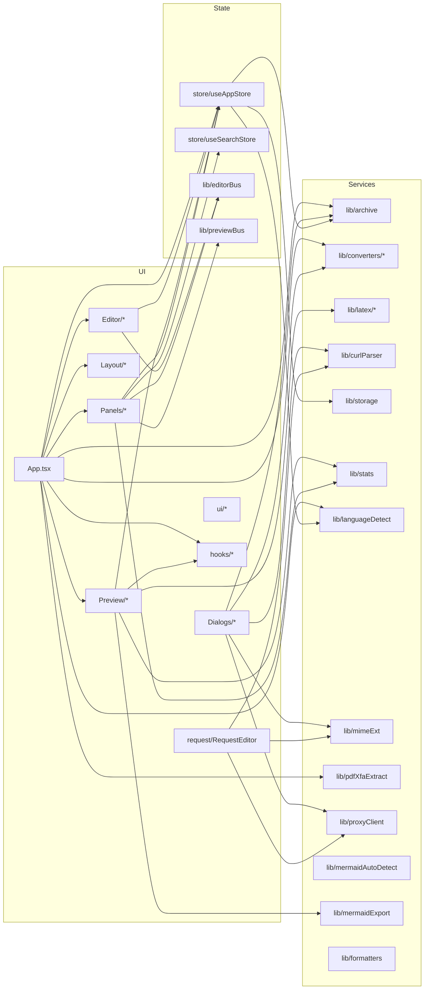

# Doc Studio — Low-Level Design (LLD)

| | |
|---|---|
| **Product** | Doc Studio |
| **Document** | Low-Level Design (LLD) — file-by-file catalogue |
| **Status** | Living — updated alongside code |
| **Audience** | Engineers modifying or extending the codebase |
| **Companions** | [HLD.md](HLD.md) — architectural context · [TDD.md](TDD.md) — scenarios & decisions |

This document enumerates **every source file in the project**, its
purpose, its public surface (exports and internal helpers of note),
and how it interacts with the rest of the codebase. Where a file
exceeds ~150 significant lines, headline exports and constants are
listed rather than every private helper.

---

## Table of contents

1. [Repository layout](#1-repository-layout)
2. [Top-level configuration](#2-top-level-configuration)
3. [Entry points (`src/App.tsx`, `src/main.tsx`)](#3-entry-points)
4. [Hooks (`src/hooks/`)](#4-hooks)
5. [Layout components (`src/components/Layout/`)](#5-layout-components)
6. [Editor components (`src/components/Editor/`)](#6-editor-components)
7. [Preview components (`src/components/Preview/`)](#7-preview-components)
8. [Panel components (`src/components/Panels/`)](#8-panel-components)
9. [Dialog components (`src/components/Dialogs/`)](#9-dialog-components)
10. [Request editor (`src/components/request/`)](#10-request-editor)
11. [UI primitives (`src/components/ui/`)](#11-ui-primitives)
12. [Domain services (`src/lib/`)](#12-domain-services)
13. [Converters (`src/lib/converters/`)](#13-converters)
14. [LaTeX subsystem (`src/lib/latex/`)](#14-latex-subsystem)
15. [State store (`src/store/`)](#15-state-store)
16. [Types (`src/types/`)](#16-types)
17. [Server (`server/`)](#17-server)
18. [Vite plugins (`vite-plugins/`)](#18-vite-plugins)
19. [Scripts (`scripts/`)](#19-scripts)
20. [Native shells (`src-tauri/`, Capacitor)](#20-native-shells)
21. [CI workflows (`.github/workflows/`)](#21-ci-workflows)
22. [Cross-file dependency graph](#22-cross-file-dependency-graph)
23. [Extension points](#23-extension-points)

---

## 1. Repository layout

```
C:\Tools\MdToHtmlPdfConverter\
├── docs/                       HLD · LLD · TDD · README
├── public/                     Static assets: favicon, icons, robots.txt
├── scripts/                    Build-side tooling (icon gen, latex patch, xfa test)
├── server/                     Optional Express host for /__proxy
├── src/                        SPA — see §3–§16
├── src-tauri/                  Tauri 2 desktop shell (Rust)
├── vite-plugins/               Custom Vite plugins (dev-proxy)
├── .github/workflows/          CI: web+docker, tauri, android, ios
├── android/, ios/              Capacitor-generated native projects (git-ignored)
├── capacitor.config.ts         Capacitor 6 config
├── Dockerfile · docker-compose.yml
├── package.json · package-lock.json
├── postcss.config.js · tailwind.config.js
├── tsconfig.json · tsconfig.node.json
├── vite.config.ts · vite.config.single.ts · vitest.config.ts
└── README.md · DEPLOYMENT.md
```

---

## 2. Top-level configuration

### 2.1 [`package.json`](../package.json)

Declares dependencies, scripts, and PWA metadata.

Key scripts:

| Script | Purpose |
|--------|---------|
| `dev` | `vite` — dev server on 5173 with `/__proxy` mounted via [dev-proxy plugin](../vite-plugins/dev-proxy.ts) |
| `build` | `tsc --noEmit && vite build` — type check then produce `dist/` |
| `build:single` | `tsc --noEmit && vite build --config vite.config.single.ts` — produce single-file `dist-single/index.html` |
| `preview` | `vite preview` — smoke-test the production bundle |
| `prebuild:icons` | Rasterise SVGs into PWA / iOS / Android icons via [gen-icons.ts](../scripts/gen-icons.ts) |
| `postinstall` | Runs [patch-latexjs.mjs](../scripts/patch-latexjs.mjs) — removes `.keep` files that break Vite's esbuild pre-bundler |
| `test` | `vitest run` — one-shot |
| `test:watch` | `vitest` — interactive |
| `test:ui` | `vitest --ui` — browser dashboard |
| `server` | `node --loader ts-node/esm server/index.ts` — production static + proxy host |

### 2.2 [`tsconfig.json`](../tsconfig.json)

Strict mode on, `moduleResolution: bundler`, `@/*` path alias mirrored
into Vite's `resolve.alias`. `tsconfig.node.json` extends it for the
Vite config file itself and for `scripts/`.

### 2.3 [`vite.config.ts`](../vite.config.ts)

Highlights:

- `stubKeepFilesPlugin` — short-circuits `.keep` resolution in **both**
  Rollup and esbuild passes; belt-and-braces with `patch-latexjs.mjs`.
- `@` path alias.
- Regex alias mapping `^latex\.js\/dist\/css\/(.+)$` to the on-disk
  path so Vite can resolve latex.js's non-standard subpath imports.
- vite-plugin-pwa with `registerType: 'autoUpdate'` and full manifest
  (name, theme colour, maskable icons, apple-touch icon).
- `build.target: 'es2020'`, `sourcemap: false`,
  `chunkSizeWarningLimit: 900`.
- `manualChunks`: `react-vendor`, `markdown` (react-markdown + remark
  + rehype), `converters` (mammoth chunk + turndown), `codemirror`
  (core), `codemirror-langs` (per-language), `pdf` (jspdf +
  html2canvas), `mermaid`.

KaTeX is **not** manually chunked — a previous experiment produced
duplicated copies in the bundle; Rollup's auto-splitter handles it
better.

### 2.4 [`vite.config.single.ts`](../vite.config.single.ts)

Adds `viteSingleFile()`, sets `cssCodeSplit: false`,
`assetsInlineLimit: 100_000_000`, `inlineDynamicImports: true`,
`outDir: 'dist-single'`. All lazy chunks become synchronous; PWA
plugin is disabled (no service worker in a file that may run from
`file://`).

### 2.5 [`vitest.config.ts`](../vitest.config.ts)

Deliberately separate from `vite.config.ts` so tests don't drag in
vite-plugin-pwa or the LaTeX chunking plugins. Only the `@` alias is
mirrored. `environment: 'node'`, `include: ['src/**/*.{test,spec}.{ts,tsx}']`.

### 2.6 [`tailwind.config.js`](../tailwind.config.js)

`darkMode: 'class'` (toggled by `useTheme` writing `dark` on
`<html>`), custom colour palette (`brand`, `night-soft`, `night-muted`),
`shadow-soft` utility, `@tailwindcss/typography` for markdown preview.

### 2.7 [`Dockerfile`](../Dockerfile) + [`docker-compose.yml`](../docker-compose.yml)

Two-stage: `builder` runs `npm ci && npm run build`; `runner` is a
`node:20-bookworm-slim` image that boots [server/index.ts](../server/index.ts).

### 2.8 [`capacitor.config.ts`](../capacitor.config.ts)

Points `webDir` at `dist`. `androidScheme: 'https'` avoids mixed-content
blocks in the WebView; `allowNavigation: ['*']` opens outbound HTTPS
navigation for the API workbench.

---

## 3. Entry points

### 3.1 [`src/main.tsx`](../src/main.tsx)

Bootstraps React, imports global CSS (`index.css`, `katex.min.css`),
and registers the PWA service worker via the virtual
`virtual:pwa-register` module. `onNeedRefresh` triggers a toast that
prompts the user to reload.

### 3.2 [`src/App.tsx`](../src/App.tsx)

Top-level composition. Responsibilities:

- Kicks off `useAppStore.getState().hydrate()` on first mount.
- Sets up `useTheme`, `useKeyboardShortcuts`, `useMermaidTheme`.
- Renders `Header`, `Sidebar`, `CodeEditor`, one of the preview
  components (via `PreviewMode` + language routing), `StatusBar`,
  and `ToastHost`.
- Implements `useDebounced(value, 180)` — coalesces preview
  re-renders during typing.
- `fileToDoc(file)` — dispatches a dropped/opened file to the right
  converter based on extension:

  | Extension | Converter |
  |-----------|-----------|
  | `.md`, `.markdown` | Raw text |
  | `.html`, `.htm` | `htmlToMarkdown` (embedded HTML) |
  | `.json` | Raw text, `language: 'json'` |
  | `.xml`, `.xdp`, `.xfd`, `.xfdf`, `.fdf` | Raw text, `language: 'xml'` |
  | `.docx` | `docxToMarkdown` |
  | `.pdf` | `extractXfaXml` → XML or a placeholder if none |
  | `.zip`, `.epub`, `.tex` | Handled upstream by the archive path in `Header`/`Sidebar` |

- Exposes `LoadedFile { file, doc }` for callers that want both.

---

## 4. Hooks

### 4.1 [`src/hooks/useTheme.ts`](../src/hooks/useTheme.ts)

Reads `settings.theme` (`'light' \| 'dark' \| 'system'`). For
`'system'`, subscribes to `matchMedia('(prefers-color-scheme: dark)')`
and rewrites `<html class="dark">` accordingly. Also updates
`<meta name="theme-color">` so mobile browser chrome matches.

Exports: `useTheme()`.

### 4.2 [`src/hooks/useKeyboardShortcuts.ts`](../src/hooks/useKeyboardShortcuts.ts)

Global keydown listener. Handles Ctrl/Cmd + S (autosave hint toast),
Z (undo), Shift+Z / Ctrl+Y (redo), B (toggle editor/preview), `/`
(split), F11 (toggle zen). Ignores events when the target is an
editable field except for the toggles that make sense there.

Exports: `useKeyboardShortcuts()`.

### 4.3 [`src/hooks/useMermaidTheme.ts`](../src/hooks/useMermaidTheme.ts)

Watches the `<html>` element for `dark` class changes via a
`MutationObserver`. When it flips, re-initialises the mermaid singleton
so newly rendered diagrams pick up the correct palette.

Exports: `resolveMermaidTheme(dark: boolean): MermaidTheme`,
`useMermaidTheme(): MermaidTheme`.

### 4.4 [`src/hooks/usePreviewSearch.ts`](../src/hooks/usePreviewSearch.ts)

Backs the sidebar Search panel's live preview highlights using the
CSS Custom Highlight API (`CSS.highlights`). Two named highlights:
`search-preview` (all matches) and `search-preview-current` (the
active jump target).

Exports: `usePreviewSearch(container, query, {caseSensitive, useRegex}): { count, index, next, prev, jumpTo }`.

Key private helpers: `escapeRegExp`, `buildRegex`, `collectRanges`
(walks text nodes, groups matches into `Range` objects),
`scrollRangeIntoView`, `findScrollableAncestor`.

Exposed named-highlight constants: `ALL_NAME = 'search-preview'`,
`CURRENT_NAME = 'search-preview-current'`.

### 4.5 [`src/hooks/usePreviewFocus.ts`](../src/hooks/usePreviewFocus.ts)

Used by the Table-of-Contents panel to scroll a specific outline item
into view inside the preview. Given a needle string + occurrence
index, walks text nodes to build the Nth `Range` and highlights it via
Custom Highlight API (`FOCUS_HIGHLIGHT_NAME = 'search-preview-current'`).

Exports: `usePreviewFocus(container)` for the markdown/LaTeX preview,
`useHtmlPreviewFocus(container)` variant for the sanitised HTML
preview.

---

## 5. Layout components

### 5.1 [`src/components/Layout/Header.tsx`](../src/components/Layout/Header.tsx)

Top strip. Owns:

- File picker (`<input type="file" multiple>` — hidden, triggered by
  button click).
- New Markdown / New JSON / New XML / New HTML doc buttons.
- Import cURL / Import URL / Export dialog triggers.
- Theme cycle button, zen toggle, workspace switcher menu.
- `ARCHIVE_HANDLED = Symbol('archive-handled')` — marker so the drop
  handler knows an archive-aware component already claimed the drop
  and it shouldn't fall back to plain-text open.

Props: `{ onOpenSidebar: () => void }`.

### 5.2 [`src/components/Layout/Sidebar.tsx`](../src/components/Layout/Sidebar.tsx)

Left rail with tabbed panels. Type:
`TabId = 'outline' | 'search' | 'files' | 'archives' | 'recent' | 'stats'`.

The `TABS` array pairs each id with an icon and a render function that
returns the corresponding panel component. Mobile: slides in over the
editor; desktop: fixed rail.

### 5.3 [`src/components/Layout/StatusBar.tsx`](../src/components/Layout/StatusBar.tsx)

Bottom strip. Shows word count (via `computeStats`), read-time,
character count, saved indicator (900 ms debounce so the "Saved"
label flashes when autosave runs), language pill, view mode toggle.
`showPreviewToggle = language === 'markdown'` — only markdown gets the
HTML/PDF preview toggle.

### 5.4 [`src/components/Layout/WorkspaceSwitcher.tsx`](../src/components/Layout/WorkspaceSwitcher.tsx)

Menu that lists workspaces via `listWorkspaces()` (scans localForage
keys for `ws-*` prefixes), lets the user open one in a new window
(`openWorkspaceInNewWindow(id)` = `window.open('?ws=<id>')`), delete
one (`deleteWorkspace(id)` — refuses to delete the current workspace),
or create a new one.

---

## 6. Editor components

### 6.1 [`src/components/Editor/CodeEditor.tsx`](../src/components/Editor/CodeEditor.tsx)

Hosts a single CodeMirror 6 instance. Highlights:

- `langExtension(lang)` — returns the right `@codemirror/lang-*`
  extension; falls back to a plain state.
- `Compartment` for hot-swapping language when the active doc changes
  without recreating the view.
- `isDarkNow(theme)` — `theme === 'dark' || (theme === 'system' && prefers-dark)`.
  Feeds `oneDark` theme extension.
- Publishes the view to [`editorBus`](../src/lib/editorBus.ts) on
  mount, retracts on unmount.
- Drag-over/drop handling delegates to `onDropFiles` prop so the
  parent can route files through `fileToDoc`.

Props: `{ onDropFiles: (files: File[]) => void }`.

### 6.2 [`src/components/Editor/EditorTabs.tsx`](../src/components/Editor/EditorTabs.tsx)

Horizontal tab strip above the editor. Highlights:

- `LANG_BADGE: Record<Language, string>` — the coloured mini badge.
- `isDirty(file)` — compares `content` against `original`.
- Right-click context menu (`MenuState { x, y, fileId }`) with Close,
  Close others, Close all, Save-as-collection.
- Close-with-unsaved-work: shows a dialog offering Stash-into-Unsaved
  (calls `closeFilesHelper` with `stashUnsaved: true`).

---

## 7. Preview components

### 7.1 [`src/components/Preview/MarkdownPreview.tsx`](../src/components/Preview/MarkdownPreview.tsx)

The full react-markdown pipeline. `memo`-wrapped; only re-renders when
`content` reference changes. Configured plugins:

| Kind | Plugin |
|------|--------|
| remark | `remark-gfm`, `remark-emoji`, `remark-math` |
| rehype | `rehype-highlight`, `rehype-slug`, `rehype-raw`, `rehype-katex` |

Special behaviours:

- Detects mermaid fenced blocks in the AST and swaps them for
  `<MermaidBlock>` renderers.
- Runs `looksLikeLatexDocument(content)`; if true, lazy-imports
  `LatexPreview` and renders it in place of the standard body.
- When LaTeX is active, also renders `<LatexStylePanel>` above the
  preview so the user can tune knobs.

### 7.2 [`src/components/Preview/LatexPreview.tsx`](../src/components/Preview/LatexPreview.tsx)

Default-exported (matches `React.lazy()`). Renders a full LaTeX
document via latex.js. Highlights:

- Ships its own `latex.js/dist/css/base.css` + `article.css` — imported
  here (not at app root) so the CSS lands in the same lazy chunk as
  the engine.
- Imperatively adopts the parser's `HTMLDocument` `<body>` children
  via `cloneNode(true)` at ~line 84 — avoids React re-serialising
  100 KB of HTML on every keystroke.
- `applyHfillLayout(host)` — post-processes `HFILL_SENTINEL` markers
  into flexbox spacers (\hfill support).
- `injectHeadingIds(host)` — walks h1–h6 in DOM order, assigns
  `slugify()`-based ids with Map-based deduplication. Enables the
  Table-of-Contents scroll for LaTeX documents.
- Reports parser errors up via `onError(message)` so
  `MarkdownPreview` can fall back to the regex-based `texToMarkdown`
  pipeline for a graceful failure mode.

Props: `{ source, className, paper, onError }`.

### 7.3 [`src/components/Preview/LatexStylePanel.tsx`](../src/components/Preview/LatexStylePanel.tsx)

Ten numeric knobs (`fontSizePx`, `lineHeight`, `pagePaddingIn`,
`h2MarginTopEx`, `h2MarginBottomEx`, `h2FontSizeEm`, `hugeFontSizeEm`,
`listIndentEm`, `listItemSpacingRem`, `paragraphSpacingRem`), three
presets (Overleaf-Tight, Balanced, Roomy), plus:

- Copy CSS — dumps a CSS-vars block to clipboard.
- Import CSS — pastes a CSS block back and reverse-maps via
  `parseCssBlock`.
- Reset to defaults.

Props: `{ value: LatexStyleConfig, onChange: (next) => void, className? }`.

### 7.4 [`src/components/Preview/HtmlPreview.tsx`](../src/components/Preview/HtmlPreview.tsx)

`memo(forwardRef)`. Renders raw HTML in a sandboxed way — does **not**
use an iframe (which would break KaTeX / mermaid theming). Instead
runs `sanitize(html)` which:

- Strips all `on*=` attributes.
- Rewrites `javascript:` URLs to `#`.

Uses `dangerouslySetInnerHTML`. Callers should treat input as
untrusted; if content comes from external HTTP sources, add DOMPurify.

### 7.5 [`src/components/Preview/SourcePreview.tsx`](../src/components/Preview/SourcePreview.tsx)

`memo(forwardRef)`. Pretty-prints JSON or XML for the preview pane.
Helpers: `prettyJson`, `prettyXml`, `serializeXml`, `escapeText`,
`escapeAttr`. Falls back to raw text with an inline error banner if
parsing fails — never leaves the user with a blank preview.

### 7.6 [`src/components/Preview/MermaidBlock.tsx`](../src/components/Preview/MermaidBlock.tsx)

Renders a single Mermaid diagram. Highlights:

- Lazy singleton `mermaidPromise` — first `<MermaidBlock>` in the
  session dynamically imports `mermaid`.
- `initialized` guard prevents `mermaid.initialize()` from being
  called twice per theme flip.
- Theme-aware — re-renders when `useMermaidTheme()` returns a new
  value.
- Hover toolbar with three actions: Copy SVG, Save PNG (3×
  device-pixel ratio for retina), Save SVG.
- `data-ui-only` attribute on the toolbar wrapper so HTML export can
  strip it.

### 7.7 [`src/components/Preview/CurlRequestPreview.tsx`](../src/components/Preview/CurlRequestPreview.tsx)

Renders a saved cURL request envelope from a collection. Types:

- `CurlEnvelope` — `{ kind: 'doc-studio/curl-request', request, response? }`.
- `tryParseEnvelope(text)` → `CurlEnvelope | null` (safe JSON parse
  + shape check).
- `looksLikeCurlEnvelope(text)` — fast substring probe used before
  triggering the full parse.
- `classifyResponse(contentType)` — routes to a JSON / XML / HTML /
  binary sub-viewer.
- `shortHost(url)` — for the header pill.
- `textExtFor(contentType)` — file-extension hint for the "Open
  response as tab" action.

---

## 8. Panel components

### 8.1 [`src/components/Panels/TableOfContents.tsx`](../src/components/Panels/TableOfContents.tsx)

Renders an outline extracted from the current document. Dispatches by
language:

| Language | Extractor |
|----------|-----------|
| `markdown` | `extractToc` (headings + LaTeX sectioning commands) |
| `json` | `extractJsonOutline` (top-level keys) |
| `xml` | `extractXmlOutline` (recursive elements) |
| `html` | not surfaced — HTML preview has its own headings |

Clicking an item:

1. Calls `previewFocusItem(item)` to scroll the preview.
2. If the item has `line` / `col`, calls
   `getEditorView()?.dispatch(...)` to move the CodeMirror cursor.

### 8.2 [`src/components/Panels/SearchPanel.tsx`](../src/components/Panels/SearchPanel.tsx)

Search-and-replace inside the current document. Types:
`Match { line, lineText, matchStartInLine, ... }`,
`SearchQuery { text, caseSensitive, useRegex }`.

Ops: `findNext`, `findPrev`, `replaceNext`, `replaceAll`. Live
preview highlighting via `usePreviewSearch` (mounted on the
preview root).

### 8.3 [`src/components/Panels/StatsPanel.tsx`](../src/components/Panels/StatsPanel.tsx)

Uses `useMemo(() => computeStats(content), [content])` to render word
count, character count, read time (words / 220 WPM), heading count.

### 8.4 [`src/components/Panels/ArchivePanel.tsx`](../src/components/Panels/ArchivePanel.tsx)

Tree view of every open archive/collection. Highlights:

- `FOLDER_KEEP = '.folder-keep'` — sentinel entry for empty folders.
- MIME constants for drag-and-drop: `DND_ENTRY`, `DND_FOLDER`,
  `DND_DOC` — enable moving entries between collections, whole folders,
  or a live document tab into a collection.
- `DndPayload`, `DndDocPayload` — the JSON body serialised on drag.
- Click an entry → `openArchiveEntry(archiveId, path)`.
- Right-click → rename, remove, "Export archive".
- Auto-collapses long trees; virtualises when >200 entries.

### 8.5 [`src/components/Panels/ActiveFiles.tsx`](../src/components/Panels/ActiveFiles.tsx)

List of currently open tabs, grouped by archive. Reuses `LANG_BADGE`
and `isDirty` from `EditorTabs`. `×` on any row closes the tab —
routes through the `closeFile(id, { stashUnsaved: true })` action
so unsaved orphan tabs land in the auto-created "Unsaved" collection.

### 8.6 [`src/components/Panels/RecentDocuments.tsx`](../src/components/Panels/RecentDocuments.tsx)

Lists LRU recents (max 12). `relative(ts)` formats a timestamp as
"just now", "Nm", "Nh", or "Nd". Click reopens.

---

## 9. Dialog components

### 9.1 [`src/components/Dialogs/ExportDialog.tsx`](../src/components/Dialogs/ExportDialog.tsx)

Export the active document. Modes:

| HTML flavour | Meaning |
|--------------|---------|
| `standalone` | `<html><head><style>…</style></head><body>…</body></html>` with embedded print-friendly CSS |
| `embedded` | Same, but the rendered preview root is inlined literally (styles unchanged) |
| `clean` | Body content only, no wrapper — for pasting into a CMS |

Also exports to Markdown (raw), JSON (raw), XML (raw), and PDF via
`exportHtmlToPdf`. Helpers: `sanitizeFilename` (Windows-safe),
`download(blob, filename)`. Uses `guessFileExtension` for the default
filename.

### 9.2 [`src/components/Dialogs/CurlImportDialog.tsx`](../src/components/Dialogs/CurlImportDialog.tsx)

Paste a `curl …` command. Parses via `parseCurl(command)`, previews
the resulting `EditableRequest`, hands off to `RequestEditor`.
`classifyResponse` and `shortHost` reused here for the response
preview after a test send.

### 9.3 [`src/components/Dialogs/UrlImportDialog.tsx`](../src/components/Dialogs/UrlImportDialog.tsx)

Enter a URL + optional headers (`HeaderRow { name, value }`). Uses
`fetchViaProxyOrDirect` under the hood. `classify(url, contentType)`
decides whether to save as a document tab, a JSON tab, an XML tab, or
unpack via `detectArchiveKind + unpackArchive` if the response is an
archive.

### 9.4 [`src/components/Dialogs/ArchiveExportDialog.tsx`](../src/components/Dialogs/ArchiveExportDialog.tsx)

Repack a collection. Modes:

| Mode | Behaviour |
|------|-----------|
| `zip` | Straight repack via JSZip |
| `concat-by-type` | One file per language, entries concatenated with `---` separators |
| `concat-all` | Single Markdown file, all entries concatenated |

`downloadBlob(blob, filename)` helper.

---

## 10. Request editor

### 10.1 [`src/components/request/RequestEditor.tsx`](../src/components/request/RequestEditor.tsx)

The Postman-style form. Type:

```ts
interface EditableRequest {
  url: string;
  method: string;
  headers: HeaderRow[];
  body: string;
  insecure: boolean;
  formParts: FormPart[];      // for multipart
  attachments: File[];        // browser File refs to attach
}
```

Round-trip helpers: `toEditable(parsedCurl)`, `toParsedCurl(editable)`.
Binary attachment helper `blobToBase64(file)` uses a chunked
FileReader loop.

Send button calls `fetchViaProxyOrDirect(editable.url, {...})`; on
success, the response is passed to `CurlRequestPreview` (rendered
inline) and offered as a "Save request + response" collection entry.

---

## 11. UI primitives

### 11.1 [`src/components/ui/Button.tsx`](../src/components/ui/Button.tsx)

Tailwind-composed `<button>`. Variants: `primary | ghost | outline |
subtle | danger`. Sizes: `sm | md | icon`. `forwardRef`. Focus ring
via `focus-visible:ring-brand-500/60`.

### 11.2 [`src/components/ui/Modal.tsx`](../src/components/ui/Modal.tsx)

`createPortal(children, document.body)` so the modal escapes ancestor
stacking contexts and backdrop-filter clipping. Locks body scroll
while open; listens for Escape.

Props: `{ open, onClose, title, children, wide? }`.

### 11.3 [`src/components/ui/Toast.tsx`](../src/components/ui/Toast.tsx)

Zustand-backed toast queue. Imperative API `toast.success/error/info`
usable from anywhere including store actions. Auto-dismisses after
3200 ms. `ToastHost` component renders the stack at
`fixed bottom-4 right-4 z-[60]`.

### 11.4 [`src/components/ui/Tooltip.tsx`](../src/components/ui/Tooltip.tsx)

Deliberately lightweight — no portal, no positioning library.
Hover/focus reveal with a 400 ms show timer stored in a `useRef`
handle so unmount clears it.

Props: `{ label, children, side?: 'top' | 'bottom' }`.

---

## 12. Domain services

### 12.1 [`src/lib/archive.ts`](../src/lib/archive.ts)

Unpack + repack + preview generation for container archives.

Constants:

| Name | Value / meaning |
|------|-----------------|
| `RENDERED_PREVIEW_PATH` | `(rendered preview).md` — synthetic entry name for DOCX/XLSX/PPTX/TEX previews |
| `CONTAINER_EXT_TO_KIND` | `{ '.docx': 'docx', '.xlsx': 'xlsx', ... }` |
| `PRIMARY_PATH` | Per-kind preferred entry to open first |
| `EXT_TO_LANGUAGE` | Maps every text-file extension to `Language` |
| `IMAGE_EXT_MIME` | `.png → image/png`, etc. |
| `MAX_INLINE_IMAGE_BYTES` | 3 MB — larger images become "download only" |
| `MAX_TEXT_PRELOAD_BYTES` | 1 MB — larger text entries load on click |
| `MAX_DOCX_RENDER_BYTES` | 8 MB — larger DOCX skip the mammoth pass |
| `YIELD_EVERY` | 32 — entries per `yieldToBrowser()` micro-task |

Exports:

- `detectArchiveKind(fileName | mimeType): ArchiveKind | null`
- `unpackArchive(file: Blob | ArrayBuffer): Promise<Archive>`
- `renderPreviewFor(archive): Promise<ArchiveEntry | null>`
- `buildTexArchive(source, name)` — wraps `.tex` files as a
  single-entry archive so they get the same tree treatment.
- `formatSize(bytes)`, `uint8ToBase64(bytes)`, `makeArchiveId()`,
  `yieldToBrowser()`.

### 12.2 [`src/lib/curlParser.ts`](../src/lib/curlParser.ts)

Regex + hand-tokenised parser. Handles the DevTools "Copy as cURL"
pastes and most Postman exports. Types:

```ts
interface FormPart { name; kind: 'text' | 'file'; value?; contentType?; filename? }
interface ParsedCurl { url; method; headers; body; insecure; formParts; }
```

Exports: `parseCurl(command)`. Private `tokenize(input)` uses
POSIX-shell-like quoting semantics but never `eval`.

### 12.3 [`src/lib/editorBus.ts`](../src/lib/editorBus.ts)

Module-level singleton so sidebar panels can talk to the CodeMirror
view without prop drilling. Exports: `setEditorView(v)`,
`getEditorView()`, `subscribeEditorView(fn)`.

### 12.4 [`src/lib/formatters.ts`](../src/lib/formatters.ts)

Pretty-printers used by "Import" and "Format" paths.

Exports: `formatJson(text)` (throws on invalid),
`formatXml(text)` (via DOMParser + custom serialiser),
`formatCodeBlocks(markdown)` (auto-formats fenced JSON/XML blocks),
`FormatDocResult`.

Private: `escapeXmlText`, `escapeXmlAttr`, `serializeElement`,
`INDENT = '  '`.

### 12.5 [`src/lib/languageDetect.ts`](../src/lib/languageDetect.ts)

Exports:

- `detectLanguage(content: string): Language | null` — returns
  `null` for inputs shorter than 20 characters so tiny snippets
  don't get mislabelled.
- `guessFileExtension(content, language)` — picks `md`, `tex`,
  `json`, `xml`, `html`; used by Export dialog for the default
  filename.

### 12.6 [`src/lib/mermaidAutoDetect.ts`](../src/lib/mermaidAutoDetect.ts)

Auto-wraps raw Mermaid source so users don't have to type ```` ```mermaid ```` fences.

Exports: `MERMAID_DIRECTIVE` (regex),
`looksLikeMermaid(text)`, `normalizeMermaid(text)`,
`wrapAsMermaidFence(text)`, `stripFrontmatter(text)`.

### 12.7 [`src/lib/mermaidExport.ts`](../src/lib/mermaidExport.ts)

Reusable helpers shared by the per-diagram hover toolbar
(`MermaidBlock`) and the Export dialog.

Exports: `renderMermaidToSvg(source, theme, idHint?)`,
`normalizeSvgString(svg)`, `svgToPng(svg, {dprMultiplier=3})`,
`svgToPdf(svg, opts)`, `svgToStandaloneHtml(svg, opts)`,
`downloadBlob(blob, name)`.

Internally: singleton `mermaidPromise` + `lastAppliedTheme` guard.

### 12.8 [`src/lib/mimeExt.ts`](../src/lib/mimeExt.ts)

Big lookup tables + heuristics for MIME ↔ extension routing across
the app.

Exports: `MIME_TO_EXT`, `EXT_TO_MIME`, `isBinaryMime(mime)`,
`sanitizeBasename(name)`, `normalizeMime(mime)`, `extFromMime(mime)`,
`mimeFromExt(ext)`, `filenameFromContentDisposition(header)`,
`magicExt(base64)` (peek at magic bytes for common formats),
`extFromUrl(url)`, `extOfBasename(name)`,
`resolveResponseFormat({contentType, url, disposition, body}): ResolvedResponseFormat`.

### 12.9 [`src/lib/pdfXfaExtract.ts`](../src/lib/pdfXfaExtract.ts)

Extract XFA (XDP) XML from dynamic PDFs client-side. Two-pass:

1. Latin-1 scan of raw bytes for `<xdp:xdp` (uncompressed payloads).
2. Walk every `stream … endstream`, honour `/Filter /FlateDecode`,
   inflate via `DecompressionStream('deflate')`, re-scan.

Exports: `extractXfaXml(bytes): Promise<XfaExtractResult | null>`,
`isDynamicXfaPdf(bytes): Promise<boolean>`.

`XfaExtractResult { xml; source: 'raw' | 'flate-stream'; offset }`.

### 12.10 [`src/lib/previewBus.ts`](../src/lib/previewBus.ts)

Two module-level singletons for the currently mounted preview:
`PreviewSearchApi` and `PreviewFocusApi`. Last mount wins.

Exports:
- Search: `registerPreviewSearch(api)`, `previewNext()`,
  `previewPrev()`, `previewJumpTo(index)`, `previewJumpToText(text, occurrence)`.
- Focus: `registerPreviewFocus(api)`, `previewFocusItem(item)`.

### 12.11 [`src/lib/proxyClient.ts`](../src/lib/proxyClient.ts)

Client half of the CORS-bypass proxy. Handles:

- `isProxyAvailable(): Promise<boolean>` — cached probe of `/__proxy`.
- `isPrivateHost(hostname)` — matches loopback / RFC1918 / link-local /
  `.local`.
- Automatic `allowPrivate: true` when the target looks intranet.
- `fetchViaProxyOrDirect(url, opts): Promise<ProxyResult>`.
- `fetchFromCurl(parsed): Promise<ProxyResult>` — thin wrapper.
- `serialiseFormParts(parts): SerialisedFormPart[]` — turns `File`
  objects into `{filename, contentType, base64}` for JSON transport.
- `arrayBufferToBase64(buf)` — chunked 32 KiB loop; avoids
  `RangeError: Maximum call stack size exceeded` from `String.fromCharCode(...bigArray)`.
- `readResponse(resp): Promise<{...}>` — normalises text / binary
  paths.

### 12.12 [`src/lib/stats.ts`](../src/lib/stats.ts)

Computes doc stats and outline extraction. Highlights:

- `WORDS_PER_MINUTE = 220`.
- `computeStats(content): DocStats`.
- `slugify(text)` — matches `rehype-slug` exactly (Unicode-aware,
  lower-case, dash-collapse). **Exported** so `LatexPreview` can reuse
  it for heading ids.
- `HEADING_RE` — markdown ATX heading regex.
- `LATEX_SECTION_DEPTHS = { chapter:1, section:2, subsection:3, subsubsection:4, paragraph:5, subparagraph:6 }`.
- `LATEX_SECTION_RE` — matches those commands.
- `extractToc(content, language)` — dispatches to per-language extractor.
- `extractJsonOutline(content)` — walks top-level keys via a
  hand-written `JsonScanner` (`advance`, `skipWs`, `readString`,
  `skipValue`, `walkValue`, `walkObject`, `walkArray`).
- `extractXmlOutline(content)` — uses `XML_TAG_RE` scanner.
- `annotateOccurrence(items, hint)` — assigns per-hint `occurrence`
  indices so preview focus can jump to the right one.
- `lastIndexOfFrame(source, needle, from)` — utility for the JSON
  scanner.

### 12.13 [`src/lib/storage.ts`](../src/lib/storage.ts)

localForage-backed persistence + workspace ID plumbing.

Constants:

| Name | Meaning |
|------|---------|
| `DEFAULT_WORKSPACE_ID` | `'main'` — used when no `?ws=<id>` |
| `WS_SESSION_KEY` | `sessionStorage` key remembering the workspace id for this tab |
| `WORKSPACE_ID` | Immutable const, resolved once at module load |
| `WORKSPACE_KEY` | `docstudio.workspace.v3:<id>` |
| `RECENT_KEY` | `docstudio.recents:<id>` |
| `SETTINGS_KEY` | `docstudio.settings.v2` — **not** per-instance; settings are global |
| `MAX_RECENTS` | 12 |

Exports:

- `readWorkspaceIdFromUrl(): string | null` — regex-validated.
- `generateWorkspaceId(): string` — `ws-<time>-<rand>`.
- `nsKey(scope, id)` — namespacing helper.
- `loadWorkspace()`, `saveWorkspace(ws)`.
- `loadSettings()`, `saveSettings(s)`.
- `listRecents()`, `pushRecent(doc)`, `removeRecent(id)`,
  `clearRecents()`.
- `listWorkspaces(): Promise<{id, name, size}[]>`.
- `openWorkspaceInNewWindow(id)`, `deleteWorkspace(id)`.
- `newDocument(content, language): Document` — factory.
- Types: `AppSettings`, `defaultSettings`, `StoredWorkspace`.

### 12.14 [`src/lib/latex/`](../src/lib/latex/)

See [§14](#14-latex-subsystem).

---

## 13. Converters

Each converter is a self-contained, deterministic transform. Called
by [`App.tsx`](../src/App.tsx) `fileToDoc()`, by `archive.ts`
`renderPreviewFor()`, and by the Export dialog.

### 13.1 [`src/lib/converters/docxToMd.ts`](../src/lib/converters/docxToMd.ts)

Loads mammoth's UMD via `mammoth/mammoth.browser.min.js?url` + injected
`<script>` tag — the "just works" pattern for browser-only UMD libraries
in a modern bundler. `MammothLike` interface types the surface.
`docxToMarkdown(file: File): Promise<string>` runs `convertToHtml` then
`htmlToMarkdown`.

### 13.2 [`src/lib/converters/htmlToMd.ts`](../src/lib/converters/htmlToMd.ts)

Lazy dynamic imports of turndown + turndown-plugin-gfm.
`htmlToMarkdown(html): Promise<string>` — `headingStyle: 'atx'`,
`codeBlockStyle: 'fenced'`, `bulletListMarker: '-'`,
`emDelimiter: '_'`.

### 13.3 [`src/lib/converters/jsonXml.ts`](../src/lib/converters/jsonXml.ts)

Bidirectional JSON ↔ XML. Convention matches fast-xml-parser /
xml-js: `@` for attributes, `#text` for text nodes.

Exports:
- `JsonToXmlOptions { rootName?, indent?, declaration? }`
- `jsonToXml(source, opts?)`
- `xmlToJson(source)`
- `buildXml(value, name, indent, depth)`
- `sanitizeName(name)`, `escapeText(s)`, `escapeAttr(s)`,
  `elementToJson(el)`.

Documented not suitable for round-tripping mixed content or CDATA —
dialog surfaces the limitation.

### 13.4 [`src/lib/converters/mdToHtml.ts`](../src/lib/converters/mdToHtml.ts)

Wraps rendered HTML into a full standalone document.

Exports:
- `EMBEDDED_CSS` — print-friendly stylesheet with mermaid figure rules.
- `buildStandaloneHtml(bodyHtml, title, { embedCss? })`.
- `extractPreviewHtml(el: HTMLElement)` — grabs the current preview
  DOM and strips `[data-ui-only]` UI chrome.
- Private `escape(s)`.

### 13.5 [`src/lib/converters/mdToPdf.ts`](../src/lib/converters/mdToPdf.ts)

Multi-page PDF export via html2canvas + jsPDF.

Constants:

| Name | Value |
|------|-------|
| `MM_PER_INCH` | 25.4 |
| `CSS_DPI` | 96 |
| `MM_TO_PX` | ≈3.7795 |
| `A4_WIDTH_PX` | 794 |
| `A4_HEIGHT_PX` | 1123 |
| `LETTER_WIDTH_PX` | 816 |
| `LETTER_HEIGHT_PX` | 1056 |

Exports:
- `PdfExportOptions { filename, pageSize, margin, headerText, footerText, pageNumbers }`.
- `exportHtmlToPdf(html, opts): Promise<Blob>`.

Private helpers: `waitForLayout()` (2× rAF + font readiness),
`nextPaint()`, `buildRenderHost()`, `buildCaptureBackdrop()`,
`rerenderMermaidForLight(host)` (forces light theme for print).

**Design rationale — per-page capture.** html2canvas at document height
(often 6000+ px) hits the browser 32767 px canvas limit for
mid-length docs. Per-page transform-then-capture keeps every canvas
within limits and yields a text-selectable PDF when combined with
jsPDF's font overlays for headers / footers / page numbers.

### 13.6 [`src/lib/converters/pptxToMd.ts`](../src/lib/converters/pptxToMd.ts)

`slideNumber(path)`, `parseSlideParagraphs(xml)`,
`pptxToMarkdown(zip: JSZip): Promise<string>`. One `## Slide N`
heading per slide; empty slides preserved so numbering matches Slide
Sorter.

### 13.7 [`src/lib/converters/texToMd.ts`](../src/lib/converters/texToMd.ts)

Regex-based `.tex` → Markdown preview. Explicitly not a LaTeX engine —
it's the fallback path when `LatexPreview` fails and the "give me a
preview without a toolchain" path for very simple documents.

Exports:
- `texToMarkdown(source)`.
- `looksLikeLatexDocument(source)` — used by `MarkdownPreview` to
  decide whether to lazy-load `LatexPreview`.

Private helpers (chained inside `texToMarkdown`):
`stripComments`, `extractMeta` (`\title`, `\author`, `\date`),
`extractBody` (extracts `\begin{document} … \end{document}`),
`transformLists`, `normalisePipeSeparator`, `dedentEnvBody`,
`transformCommands` (sectioning + `\textbf` etc.),
`mdInlineToHtml`, `transformHfillLines`, `unwrapBraceGroups`,
`tidyWhitespace`.

### 13.8 [`src/lib/converters/xlsxToMd.ts`](../src/lib/converters/xlsxToMd.ts)

Pure `DOMParser` — no SheetJS. Handles shared strings, numbers,
inline strings, formula strings, booleans. One `## Sheet name`
heading per worksheet + a GFM table.

Private helpers: `colFromRef` (`AB12` → column index), `escapeCell`,
`readSharedStrings(zip)`, `readSheetList(zip)`,
`fallbackSheetList(zip)`, `parseSheetToMarkdown(zip, path)`.

Public: `xlsxToMarkdown(zip): Promise<string>`.

---

## 14. LaTeX subsystem

### 14.1 [`src/lib/latex/latexStyleConfig.ts`](../src/lib/latex/latexStyleConfig.ts)

The 10-knob shape and the presets.

Exports:
- `LatexStyleConfig` — 10 numeric fields (`fontSizePx`, `lineHeight`,
  `pagePaddingIn`, `h2MarginTopEx`, `h2MarginBottomEx`,
  `h2FontSizeEm`, `hugeFontSizeEm`, `listIndentEm`,
  `listItemSpacingRem`, `paragraphSpacingRem`).
- `DEFAULT_STYLE`.
- `PRESETS` — three curated named presets:
  `'Overleaf-Tight'`, `'Balanced'`, `'Roomy'`.
- `toCssVars(cfg)` → `Record<string,string>`.
- `toCssBlock(cfg)` — pretty CSS `:root { --… }` string.
- `CSS_VAR_TO_KEY` — reverse map for Import CSS.
- `ParseCssResult`.
- `parseCssBlock(text): ParseCssResult` — extracts known vars,
  ignores unknown ones with a warning.
- `STORAGE_KEY = 'docstudio.latexStyle.v1'`.
- `loadFromStorage()`, `saveToStorage(cfg)`.

Tested by [`latexStyleConfig.test.ts`](../src/lib/latex/latexStyleConfig.test.ts).

### 14.2 [`src/lib/latex/sanitizeLatexForEngine.ts`](../src/lib/latex/sanitizeLatexForEngine.ts)

latex.js only supports a subset of packages; this module strips the
unsupported ones so real-world documents parse.

Constants:

- `UNSUPPORTED_PACKAGES: Set<string>` — packages we drop
  (`geometry`, `hyperref` in preamble form, `fancyhdr`, `titlesec`,
  `tikz`, …).
- `COMMANDS_TO_STRIP: Record<string, number>` — command name →
  argument count to consume (`\usepackage` = 1, `\setlength` = 2, …).
- `BARE_COMMANDS_TO_STRIP: Set<string>` — arg-less commands to
  simply erase.
- `HFILL_SENTINEL = '\uE000HFILL\uE001'` — Private-Use-Area marker
  survives latex.js and gets converted to a flex spacer by
  `applyHfillLayout` in `LatexPreview`.

Exports:
- `sanitizeLatexForEngine(src): string` — the main entry point.

Private helpers: `skipWs`, `skipBraceGroup`, `skipOptionGroup`,
`stripUsepackage`, `stripArgCommands`, `splitPreamble`,
`sanitizeHrefUrls` (turns `\href{url}{text}` into just `text` for
plain rendering), `promoteSectionsToStarred` (avoids latex.js
numbering when the doc already has custom numbering),
`replaceHfill`.

---

## 15. State store

### 15.1 [`src/store/useAppStore.ts`](../src/store/useAppStore.ts)

The mono-store. ~1400 lines, ~40+ actions. See [HLD §10](HLD.md#10-state-ownership--lifecycle) for lifecycle semantics.

Constants:

| Name | Value / meaning |
|------|-----------------|
| `HISTORY_LIMIT` | 100 undo entries |
| `HISTORY_MIN_INTERVAL_MS` | 400 ms — bursts of edits within this window collapse into a single history entry |
| `UNSAVED_COLLECTION_ID` | `'col-unsaved'` — stable id for the auto-created "Unsaved" safety-net collection |

Action groups:

- **Hydration** — `hydrate()`, `isHydrated`.
- **Documents** — `newFile()`, `openDoc(doc)`, `openDocs(docs[])`,
  `setContent(text)`, `setLanguage(lang)`, `renameFile(id, title)`,
  `closeFile(id, opts?)`, `closeMany(ids, opts?)`, `closeAll(opts?)`,
  `setActive(id)`, `saveActive()` (marks `original = content`).
- **Undo/redo** — `undo()`, `redo()`, `canUndo()`, `canRedo()`;
  history is per-document `past`/`future` arrays.
- **Archives** — `openArchive(archive)`, `closeArchive(id)`,
  `openArchiveEntry(archiveId, path)`, `saveArchiveEntry()`,
  `renameArchiveEntry(archiveId, oldPath, newPath)`,
  `removeArchiveEntry(archiveId, path)`.
- **Collections** — `createCollection(name)`,
  `addToCollection(archiveId, doc, path?)`,
  `importFilesIntoCollection(archiveId, files)`,
  `renameCollectionEntry`, `removeFromCollection`,
  `moveEntryToCollection(fromId, fromPath, toId, toFolder?)`,
  `createCollectionFolder(archiveId, folderPath)`,
  `addRawToCollection(...)`, `addBinaryToCollection(...)`.
- **View state** — `setTheme`, `setViewMode`, `setPreviewMode`,
  `toggleZen`, `toggleToc`.
- **Recents** — `removeRecentDoc(id)`.

Key private helpers:
- `scheduleWorkspaceSave(getWs)` — 700 ms debounced coalescer that
  writes to IndexedDB and pushes to recents.
- `withFile(ws, id, patch)` — immutable per-file patch that keeps
  `document` / `activeId` consistent.
- `migrateTexLanguage(ws)` — one-shot fixer for older workspaces
  where `.tex` was tagged `language: 'xml'`.
- `closeFilesHelper(getState, applyState, ids, stashUnsaved)` —
  batch close in a single transaction; stashes orphan unsaved tabs
  into the `col-unsaved` collection when `stashUnsaved: true`.
- `SAMPLE_MARKDOWN` — content used for the first-run scratch document.

### 15.2 [`src/store/useSearchStore.ts`](../src/store/useSearchStore.ts)

Small, unrelated store for search UI state (query, case sensitivity,
regex flag). Not persisted — pure per-session.

Exports: `useSearchStore` with `{ query, caseSensitive, useRegex,
setQuery, setCaseSensitive, setUseRegex }`.

---

## 16. Types

### 16.1 [`src/types/index.ts`](../src/types/index.ts)

Central type module. Full types listed in [HLD §8](HLD.md#8-core-data-model).

Notable notes:

- `Language` is a closed union of the four **editor** modes; LaTeX
  content lives under `'markdown'` and is detected at render time.
- `TocItem` carries many optional fields
  (`line`, `col`, `hint`, `needle`, `path`, `valueStart`,
  `valueEnd`, `startOffset`, `endOffset`, `occurrence`,
  `selfClosing`) so a single interface serves markdown, LaTeX,
  JSON, and XML outlines.
- `ArchiveEntry.docId` links a materialised entry back to the open
  document tab that edits it — used so autosave updates flow through
  to the collection copy without a manual "save into archive" step.

---

## 17. Server

### 17.1 [`server/index.ts`](../server/index.ts)

Express host used by the Docker channel and by anyone who wants the
CORS-bypass proxy in production. Routes:

| Route | Purpose |
|-------|---------|
| `GET /healthz` | Liveness probe |
| `POST /__proxy?url=...` | Delegated to `handleProxy` (shared with dev-proxy plugin) |
| `GET /__proxy` | Returns `400 {ok:false, needsPost:true}` — the probe endpoint the client uses to detect proxy availability |
| `GET *` | Static from `dist/` with immutable long-cache; SPA fallback returns `index.html` for unmatched routes |

Reads `PORT` (default `8080`) and `TRUST_PROXY` (`'0'`, `'1'`, or a
subnet spec) from env.

---

## 18. Vite plugins

### 18.1 [`vite-plugins/dev-proxy.ts`](../vite-plugins/dev-proxy.ts)

The heart of the CORS-bypass path. Exports a Vite plugin that adds
`/__proxy` to the dev server; exports `handleProxy(req, res)` so
`server/index.ts` can mount the same handler in production.

Constants:

| Name | Value |
|------|-------|
| `MAX_BYTES` | 16 MB response cap |
| `MAX_REQUEST_BODY` | 8 MB request body cap |
| `BLOCKED_HOST_PATTERNS` | Regexes for `127.` / `10.` / `192.168.` / `169.254.` / `172.16-31.` / `::1` / `fc*` / `fe80` |

Exports:
- `isBlockedHost(hostname): boolean` — SSRF check.
- `ProxyRequestOptions { method, headers, body, insecure, allowPrivate, formParts }`.
- `SerialisedFormPart { name, kind, value?, filename?, contentType?, base64? }`.
- `handleProxy(req, res)` — the actual HTTP handler.
- Default-exported Vite plugin factory.

Private:
- `getInsecureAgent()` — memoised undici `Agent` with
  `rejectUnauthorized: false`. Only one instance ever; sockets are
  pooled.
- `readJsonBody(req)` — streams the request body with size guard.
- `sendJson(res, status, body)`.
- `describeError(err)` — flattens `err.cause` chains for readable
  proxy error responses.

---

## 19. Scripts

### 19.1 [`scripts/gen-icons.ts`](../scripts/gen-icons.ts)

Rasterises `public/icons/*.svg` into the PNG sizes browsers, Android
launchers, and iOS home-screen require. Uses `@resvg/resvg-js`.
Targets: `icon-192.png`, `icon-512.png`, `icon-192-maskable.png`,
`icon-512-maskable.png`, `apple-touch-icon.png` (180×180),
`favicon-32.png`, `favicon-16.png`. Wired into `npm run prebuild:icons`.

### 19.2 [`scripts/patch-latexjs.mjs`](../scripts/patch-latexjs.mjs)

Runs on `postinstall`. Deletes latex.js's two placeholder `.keep`
files that would otherwise trip Vite's esbuild pre-bundler when it
expands the library's dynamic `require()` calls into glob imports.
Idempotent; survives `npm ci` / `npm install`.

### 19.3 [`scripts/test-xfa-extract.ts`](../scripts/test-xfa-extract.ts)

Node-side sanity check for [`pdfXfaExtract.ts`](../src/lib/pdfXfaExtract.ts).
Builds a synthetic minimal PDF containing an XDP payload — one
uncompressed, one wrapped in `FlateDecode` — and asserts both are
recovered. Run: `npx tsx scripts/test-xfa-extract.ts`.

---

## 20. Native shells

### 20.1 Tauri desktop (`src-tauri/`)

- `Cargo.toml` — Rust crate manifest; pulls in `tauri` 2.x.
- `build.rs` — Tauri build script.
- `tauri.conf.json` — window size 1400×900, `minWidth: 800`,
  `minHeight: 500`, bundle targets `msi`, `nsis`, `app`, `dmg`,
  `deb`, `appimage`. Points `frontendDist` at `../dist`.
- `capabilities/` — Tauri capability manifests (least-privilege API
  gates).
- `src/main.rs` — vanilla Tauri entry with the default builder.

### 20.2 Capacitor (Android + iOS)

- [`capacitor.config.ts`](../capacitor.config.ts) —
  `appId: 'com.docstudio.app'`, `webDir: 'dist'`,
  `androidScheme: 'https'`, `iosScheme: 'app'`,
  `allowNavigation: ['*']`, `android.allowMixedContent: true` (dev
  convenience — flip for release).
- Generated `android/` and `ios/` projects are git-ignored; produced
  by `npx cap add android` / `npx cap add ios` after `npm run build`.

---

## 21. CI workflows

Four independent workflows in [`.github/workflows/`](../.github/workflows/):

| Workflow | Purpose |
|----------|---------|
| `web-and-docker.yml` | Type check + build + Docker image publish |
| `tauri-desktop.yml` | Cross-compile installers on Windows / macOS / Linux runners |
| `android.yml` | Capacitor + Gradle → APK / AAB |
| `ios.yml` | Capacitor + Xcode → IPA on a macOS runner |

Each workflow assumes the shared `dist/` bundle produced by
`vite build` (no per-channel Vite config forks — see [HLD §7.2](HLD.md#72-trade-offs)).

---

## 22. Cross-file dependency graph

Simplified — arrow = "imports from".



---

## 23. Extension points

### 23.1 Add a new editor language

1. Extend the `Language` union in [`src/types/index.ts`](../src/types/index.ts).
2. Add a `langExtension(lang)` case in
   [`CodeEditor.tsx`](../src/components/Editor/CodeEditor.tsx) with
   the CodeMirror package (install lazily via `manualChunks`).
3. Add a detector rule in
   [`languageDetect.ts`](../src/lib/languageDetect.ts) and an
   extension mapping in `guessFileExtension`.
4. Extend `EXT_TO_LANGUAGE` in
   [`archive.ts`](../src/lib/archive.ts).
5. Add an outline extractor in
   [`stats.ts`](../src/lib/stats.ts) if the language has structural
   navigation.
6. Route the preview in
   [`App.tsx`](../src/App.tsx) (choose `MarkdownPreview` /
   `HtmlPreview` / `SourcePreview` or add a new one).
7. Add a `LANG_BADGE` entry in
   [`EditorTabs.tsx`](../src/components/Editor/EditorTabs.tsx) and
   [`ActiveFiles.tsx`](../src/components/Panels/ActiveFiles.tsx).

### 23.2 Add a new container format

1. Add extension in `CONTAINER_EXT_TO_KIND` and `PRIMARY_PATH` in
   [`archive.ts`](../src/lib/archive.ts).
2. Add unpack branch inside `unpackArchive(file)`.
3. Add a preview generator in `renderPreviewFor(archive)` or a new
   converter under [`src/lib/converters/`](../src/lib/converters/).
4. Route through `fileToDoc` in
   [`App.tsx`](../src/App.tsx).

### 23.3 Add a new export target

1. Add a helper in [`src/lib/converters/`](../src/lib/converters/).
2. Add an option in
   [`ExportDialog.tsx`](../src/components/Dialogs/ExportDialog.tsx)
   and wire the download.
3. If the export is large, respect the same `MAX_BYTES` /
   `MAX_INLINE_IMAGE_BYTES` conventions.

### 23.4 Add a new proxy security constraint

1. Extend `BLOCKED_HOST_PATTERNS` or `isBlockedHost` in
   [`vite-plugins/dev-proxy.ts`](../vite-plugins/dev-proxy.ts).
2. If it affects request shape, update
   [`proxyClient.ts`](../src/lib/proxyClient.ts) client-side
   accordingly.
3. Document in [TDD §6.2 threat model](TDD.md#62-threat-model).

### 23.5 Add a new theme

1. Add colour tokens under `theme.extend.colors` in
   [`tailwind.config.js`](../tailwind.config.js).
2. Extend the `Theme` union in
   [`src/types/index.ts`](../src/types/index.ts) if the new theme
   isn't a light/dark variant.
3. Wire through [`useTheme.ts`](../src/hooks/useTheme.ts) and
   Mermaid via
   [`useMermaidTheme.ts`](../src/hooks/useMermaidTheme.ts).
