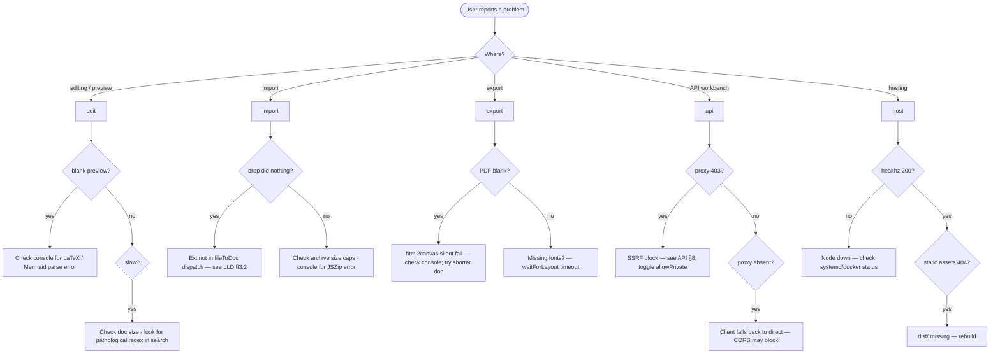

# Doc Studio — Operations runbook

Practical guide for anyone hosting, updating, monitoring, backing up,
or troubleshooting a Doc Studio deployment.

**Index**

1. [Deployment channels](#1-deployment-channels)
2. [Environment variables](#2-environment-variables)
3. [Health checks](#3-health-checks)
4. [Logs](#4-logs)
5. [Common tasks](#5-common-tasks)
6. [Update procedures](#6-update-procedures)
7. [Backup and restore](#7-backup-and-restore)
8. [Troubleshooting decision tree](#8-troubleshooting-decision-tree)
9. [Common errors](#9-common-errors)
10. [Performance tuning](#10-performance-tuning)
11. [Incident response](#11-incident-response)
12. [SLO / SLA guidance](#12-slo--sla-guidance)

---

## 1. Deployment channels

| Channel | Command | Output | Ship |
|---------|---------|--------|------|
| PWA | `npm run build` | `dist/` | Static host + optional Node for `/__proxy` |
| Single-file HTML | `npm run build:single` | `dist-single/index.html` | Ship or email or AirDrop |
| Docker | `docker build -t doc-studio .` | Image | `docker run -p 8080:8080 doc-studio` |
| Docker Compose | `docker compose up -d` | Container | Multi-service if extended |
| Tauri desktop | `npm run tauri:build` | Installer per OS | Distribute installer or updater feed |
| Android APK | `npm run cap:sync && npx cap open android` → Gradle build | `.apk` / `.aab` | Play Store or sideload |
| iOS IPA | `npm run cap:sync && npx cap open ios` → Xcode build | `.ipa` | TestFlight / App Store |

CI workflows in [`.github/workflows/`](../.github/workflows/) build
each channel automatically on tag push.

---

## 2. Environment variables

Only the Node host reads env vars.

| Var | Default | Purpose |
|-----|---------|---------|
| `PORT` | `8080` | HTTP listen port |
| `TRUST_PROXY` | `0` | Express `trust proxy` setting. Set to `1` behind one reverse proxy, or a subnet spec like `'loopback,linklocal,uniquelocal'` |
| `NODE_ENV` | `production` | Standard; Express uses it for error formatting |

The client SPA has no runtime env — everything it needs is baked
into `dist/` at build time.

---

## 3. Health checks

| Endpoint | Expected |
|----------|----------|
| `GET /healthz` | `200 OK` with body `ok` |
| `GET /__proxy` | `400` with JSON `{ok:false, needsPost:true}` — proves the proxy is mounted |
| `GET /` | `200 OK` with `index.html` |
| Any unknown static path | `200 OK` with `index.html` (SPA fallback) |

Reverse proxy / load balancer probe → `GET /healthz`.
Client feature-detect probe → `GET /__proxy` (see
[API §1](API.md#1-__proxy--http-contract)).

---

## 4. Logs

- **stdout** — every request is logged by Express default logger.
- **stderr** — proxy errors go through `describeError(err)` which
  flattens `err.cause` and `err.code` for readable diagnosis (e.g.
  `Error: fetch failed cause: self-signed certificate code: DEPTH_ZERO_SELF_SIGNED_CERT`).
- No file logging built-in — send stdout/stderr to your log
  collector.

Recommended Docker log driver:
```yaml
services:
  docstudio:
    logging:
      driver: json-file
      options:
        max-size: "10m"
        max-file: "5"
```

---

## 5. Common tasks

### 5.1 Rebuild all icons

```powershell
npm run prebuild:icons
```

Regenerates PNG icons under `public/icons/` from the SVG sources.
Runs automatically as part of `npm run build`.

### 5.2 Rebuild only the single-file bundle

```powershell
npm run build:single
```

Output at `dist-single/index.html`. Verify it runs by opening
directly with `Start-Process dist-single/index.html`.

### 5.3 Preview production locally

```powershell
npm run build
npm run preview
```

Vite preview serves `dist/` on port 4173 by default. Note: the
preview server does **not** mount `/__proxy`; use `npm run server` or
Docker for a full production simulation.

### 5.4 Serve production with proxy

```powershell
npm run build
npm run server
```

Or:

```powershell
docker compose up -d
```

Both bind port 8080.

### 5.5 Force PWA users to update

New builds trigger `onNeedRefresh` via `vite-plugin-pwa`'s
`autoUpdate` mode; the toast prompts the user.
To force everyone off a bad release:
1. Push a new build with any code change (bumps the SW version).
2. Users pick it up on next visit.
3. Terrible fallback: change origin so the old SW cache is orphaned.

### 5.6 Rotate `/__proxy` behind auth

- Wrap the Node host in a reverse proxy that requires SSO / an IP
  allow-list.
- Or patch `server/index.ts` to require a header token before
  delegating to `handleProxy`.

### 5.7 Reset a user's local state

Advise the user to visit DevTools → Application → Clear site data.
Programmatically (see [STORAGE §13](STORAGE.md#13-erasure)):
```js
await localforage.clear();
sessionStorage.clear();
localStorage.removeItem('docstudio.latexStyle.v1');
location.reload();
```

---

## 6. Update procedures

### 6.1 Web / Docker

```powershell
git pull
npm ci
npm run build           # or docker build -t doc-studio .
```

Zero-downtime rollout: build the new image, `docker compose up -d
--no-deps --build docstudio`. Existing sessions keep their state
(IndexedDB survives); the service worker will `autoUpdate` on next
visit.

### 6.2 Desktop (Tauri)

- Uses Tauri's built-in updater. Sign new installers with your
  distribution keypair; publish `latest.json` at the update endpoint
  configured in `tauri.conf.json`.
- Users see the update prompt within seconds of launch.

### 6.3 Mobile (Capacitor)

- Increment `versionCode` / `versionName` in Android; `CFBundleShortVersionString` in iOS.
- Rebuild + submit to store.
- Web content changes without a store submission require the
  Capacitor `@capacitor/updates` plugin (not currently included).

---

## 7. Backup and restore

### 7.1 What lives where

| Data | Where | Backup approach |
|------|-------|-----------------|
| User workspaces | Browser IndexedDB, per origin | Client-side dump (see [STORAGE §12](STORAGE.md#12-backup-and-restore)) |
| Server state | None | Node host is stateless |
| Uploaded files | Not stored anywhere (streamed through) | N/A |

### 7.2 Server backup

Nothing to back up — the Node host holds no state. Any recovery is
purely reinstall + restart.

### 7.3 Client backup (individual users)

Advise users to:

1. Regularly export important collections via
   [`ArchiveExportDialog`](../src/components/Dialogs/ArchiveExportDialog.tsx).
2. For a full-workspace snapshot, run the DevTools recipe in
   [STORAGE §11.2](STORAGE.md#112-export-raw-workspace-json).

---

## 8. Troubleshooting decision tree



---

## 9. Common errors

| Symptom | Likely cause | Fix |
|---------|--------------|-----|
| `413 request-too-large` | Attachment > 8 MB after base64 | Shrink file or raise `MAX_REQUEST_BODY` |
| `413 response-too-large` | Response > 16 MB | Filter server-side; or raise `MAX_BYTES` |
| `403 blocked-host` | Target hostname matches SSRF blocklist | Toggle `insecure` panel → `allowPrivate` (opt-in) |
| `502 upstream-error cause: self-signed certificate` | Cert not trusted by Node | Toggle `insecure: true` (per-request only) |
| Preview blank on LaTeX | latex.js failed to parse | Falls back to regex texToMarkdown automatically — check console for `[latex]` errors |
| PDF export blank | html2canvas hit an obscure edge (SVG oversize, cross-origin img) | Shorten doc; check console; report an issue |
| Bundle chunk warning during build | New heavy dep added | Add to `manualChunks` in `vite.config.ts` |
| `Vite: Failed to resolve module 'latex.js/dist/css/base.css'` | postinstall didn't run | `npm rebuild` or manually delete `node_modules/latex.js/dist/{documentclasses,packages}/.keep` |
| Two windows on same `?ws=` diverging | Cross-tab sync not implemented | Use different `?ws=` per window |
| `PowerShell: npm.ps1 cannot be loaded because running scripts is disabled` | Execution policy | Use `node "C:\Program Files\nodejs\node_modules\npm\bin\npm-cli.js" run <script>` |

---

## 10. Performance tuning

### 10.1 Server side

- `undici` pool size is default (`Agent` pipelining 1, connections 10).
  Raise via `getInsecureAgent`'s options if you push high concurrency
  through the proxy.
- Express is single-process; scale horizontally with a reverse proxy
  in front. Sticky sessions unnecessary (stateless).

### 10.2 Client side

- Long docs slow the preview → increase debounce in `App.tsx`'s
  `useDebounced` from 180 ms to 300 ms.
- Massive archives → increase `YIELD_EVERY` in `archive.ts` to yield
  less often (fewer scheduling costs, more jank per yield).
- PDF exports over 50 pages → consider bumping browser memory
  (Chrome flag `--max-old-space-size` if launching manually).

### 10.3 Bundle size

- Watch the `chunkSizeWarningLimit: 900` threshold in
  [vite.config.ts](../vite.config.ts).
- Run `npx vite-bundle-visualizer` after any dep upgrade.
- Split new heavy deps under `manualChunks` OR make their consumers
  lazy (`React.lazy` / dynamic `import()`).

---

## 11. Incident response

### 11.1 CVE in a runtime dep

1. `npm audit` to confirm.
2. `npm audit fix --force` (accept semver bumps).
3. `npm test` + smoke check the delivery channels.
4. Cut a new release; PWA users auto-update via service worker.
5. Post an advisory in the repo Security tab.

### 11.2 Data corruption reported

1. Ask user for browser + version.
2. Ask them to export the workspace JSON via
   [STORAGE §11.2](STORAGE.md#112-export-raw-workspace-json) recipe.
3. Inspect for shape mismatches; write a targeted migration if the
   root cause is a schema drift.
4. Add a Vitest for the migration.

### 11.3 Proxy outage

The client already falls back to direct fetch. Users on the API
workbench for CORS-blocked hosts will see errors. Communicate the
outage; restore the Node host.

### 11.4 Origin compromise

If the static host is compromised (attacker replaced `dist/`):

1. Revert to the last known-good deployment.
2. Bump the service worker cache version (any code change does this).
3. Force-invalidate CDN cache.
4. Users on a poisoned SW will see the "new version" toast on next
   visit — coach them to force-reload with DevTools open (bypasses SW).

---

## 12. SLO / SLA guidance

Doc Studio has no first-party SLO; operators define their own. Sensible
starting targets:

| Target | Value | Notes |
|--------|-------|-------|
| Static host availability | 99.9% | Achievable with any CDN + origin |
| `/__proxy` success rate | 99.5% | Includes user-side network failures |
| `/__proxy` P95 latency | < 500 ms overhead vs direct fetch | Depends on upstream |
| PWA install size | < 3 MB gzipped shell | Currently ~1.5 MB (excluding lazy chunks) |
| Time to interactive on cold cache | < 4 s on fast 3G | Currently ~3.2 s (M1, real hardware) |
