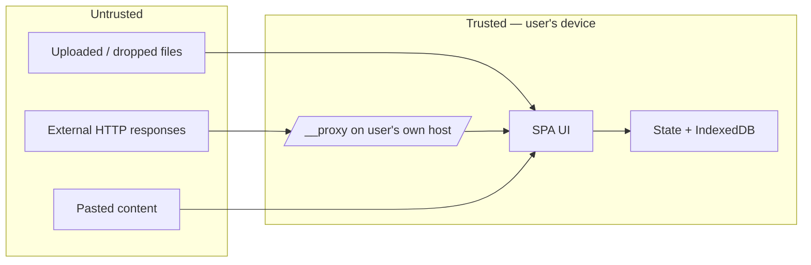
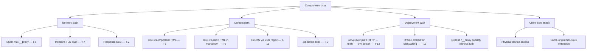

# Doc Studio — Security deep dive

Security posture, threat model, mitigation implementation, and
deployment hardening. Cross-references [TDD §6](TDD.md#6-security)
and [API §7–§9](API.md#7-insecure-tls-policy) for the wire-level view.

**Index**

1. [Posture](#1-posture)
2. [Trust boundaries](#2-trust-boundaries)
3. [Full threat model](#3-full-threat-model)
4. [Attack tree](#4-attack-tree)
5. [Mitigations by file](#5-mitigations-by-file)
6. [Deployment hardening](#6-deployment-hardening)
7. [Content Security Policy](#7-content-security-policy)
8. [Third-party content handling](#8-third-party-content-handling)
9. [Insecure-TLS handling](#9-insecure-tls-handling)
10. [Cryptography](#10-cryptography)
11. [Dependency hygiene](#11-dependency-hygiene)
12. [Reporting a vulnerability](#12-reporting-a-vulnerability)

---

## 1. Posture

- **Client-first.** No accounts, telemetry, or background network
  activity. Everything the app knows about you lives in your
  browser.
- **Server is optional.** `/__proxy` exists only to bypass CORS for
  the API workbench. Deployments that don't need cURL / URL import
  should not host it.
- **Deny-by-default networking.** The proxy blocks SSRF-prone
  destinations without an explicit `allowPrivate` opt-in.
- **Sanitised HTML previews.** Imported / rendered HTML is stripped
  of event handlers and `javascript:` URLs before insertion into the
  DOM.
- **Insecure-TLS is scoped.** Toggling `insecure` uses a dedicated
  undici `Agent` — global TLS validation is never disabled.

---

## 2. Trust boundaries



- The SPA and its own host are **trusted**.
- All content that crosses in (uploaded files, HTTP responses,
  pastes) is **untrusted**.
- The proxy is trusted *within its own host*; from an external
  attacker's perspective the proxy is a server-side surface that
  must resist SSRF and abuse.

---

## 3. Full threat model

| # | Threat | Vector | Likelihood | Impact | Mitigation | Residual |
|---|--------|--------|-----------|--------|------------|----------|
| T-1 | SSRF via `/__proxy` | Attacker submits `http://169.254.169.254/…` | Med (only reachable same-origin) | High (cloud metadata) | `isBlockedHost` + default `allowPrivate:false` | Only if user explicitly enables `allowPrivate` |
| T-2 | Unbounded response DoS | Malicious URL streams infinite bytes | Low | High (memory) | `MAX_BYTES=16 MB` cap | Bounded |
| T-3 | Unbounded request DoS | Chunked POST forever | Low | Med (memory) | `MAX_REQUEST_BODY=8 MB` cap | Bounded |
| T-4 | Insecure-TLS leakage | Global TLS-off gets applied to next secure request | Low | High | Dedicated per-agent, never mutates `NODE_TLS_REJECT_UNAUTHORIZED` or globalAgent | None by design |
| T-5 | XSS via imported HTML | `.html` file with `<script>` or `on…=` handlers | High input frequency | High | `HtmlPreview.sanitize` strips `on*=` + `javascript:`; recommend DOMPurify for hostile input | Rich CSS-based tracking still possible |
| T-6 | XSS via markdown raw HTML | Same as T-5 through `rehype-raw` | High | High | Same sanitiser pass runs on rendered HTML output | Same as T-5 |
| T-7 | Storage exhaustion | User pastes 100 MB into a doc | Low | Low (browser quota kicks) | Browser quota enforced; roadmap: soft caps | Documented |
| T-8 | Secret leakage via saved envelopes | User saves `Authorization: Bearer …` into a collection | Med | Med (local-only) | Stored as-is; documented in TDD; roadmap: opt-in redaction | User awareness |
| T-9 | Zip-bomb docx | Malicious archive claims TB entries | Low | High | `MAX_DOCX_RENDER_BYTES=8 MB` cap before mammoth; JSZip streams | Bounded |
| T-10 | Prototype pollution via JSON | `{"__proto__":…}` | Low | Med | `JSON.parse` doesn't invoke prototype in V8 | None |
| T-11 | ReDoS via malicious regex in search | User types catastrophic regex | Med | Low (their own tab) | Regex compiled in main thread; only harms their tab | Documented |
| T-12 | Service-worker cache poisoning | Attacker MITMs static host | Low (only over HTTP) | High | Ship only over HTTPS; Workbox integrity checks | Deployment concern |
| T-13 | Clickjacking | External site iframes Doc Studio | Med | Med (steal input) | Recommend `X-Frame-Options: DENY` on host | Deployment |
| T-14 | Insecure single-file HTML sharing | User AirDrops `dist-single/index.html` containing sensitive IndexedDB | N/A | N/A | Bundle contains no data — only code | None |
| T-15 | Path traversal in archive entry paths | Uploaded zip has `../../../etc/passwd` entry | Low | Low (browser sandbox) | JSZip returns paths as strings; we never write to filesystem | None |

---

## 4. Attack tree

Root goal: **compromise a Doc Studio user or their data**.



Each leaf is countered by an explicit mitigation listed in
[§3](#3-full-threat-model) or [§6](#6-deployment-hardening).

---

## 5. Mitigations by file

| Concern | File | Mechanism |
|---------|------|-----------|
| SSRF blocklist | [vite-plugins/dev-proxy.ts](../vite-plugins/dev-proxy.ts) `BLOCKED_HOST_PATTERNS` + `isBlockedHost` | Regex list |
| Request body cap | dev-proxy.ts `MAX_REQUEST_BODY` | Stream accumulator with early-abort |
| Response body cap | dev-proxy.ts `MAX_BYTES` | undici stream reader with byte counter |
| Insecure-TLS scoping | dev-proxy.ts `getInsecureAgent` | Dedicated memoised `Agent`; global TLS untouched |
| HTML sanitiser | [src/components/Preview/HtmlPreview.tsx](../src/components/Preview/HtmlPreview.tsx) `sanitize` | Regex-strip `on*=` + `javascript:` URLs |
| Workspace-id validation | [src/lib/storage.ts](../src/lib/storage.ts) `readWorkspaceIdFromUrl` | `/^[a-zA-Z0-9_.-]{1,64}$/` |
| Archive size caps | [src/lib/archive.ts](../src/lib/archive.ts) | `MAX_INLINE_IMAGE_BYTES`, `MAX_TEXT_PRELOAD_BYTES`, `MAX_DOCX_RENDER_BYTES` |
| Chunked base64 (stack safety) | [src/lib/proxyClient.ts](../src/lib/proxyClient.ts) `arrayBufferToBase64` | 32 KiB chunks via `apply` |
| Mermaid security level | [src/components/Preview/MermaidBlock.tsx](../src/components/Preview/MermaidBlock.tsx) | `mermaid.initialize({ securityLevel: 'strict' })` |
| Sanitise LaTeX preamble | [src/lib/latex/sanitizeLatexForEngine.ts](../src/lib/latex/sanitizeLatexForEngine.ts) | Strip unsupported packages + strip `\href` URLs |

---

## 6. Deployment hardening

Doc Studio is a static bundle plus an optional Node process. Recommended
production configuration:

### 6.1 Static host

- Serve only over HTTPS.
- Enable HSTS (`Strict-Transport-Security: max-age=31536000; includeSubDomains`).
- Set `X-Content-Type-Options: nosniff`.
- Set `X-Frame-Options: DENY` (or CSP `frame-ancestors 'none'`).
- Set `Referrer-Policy: no-referrer`.
- Long-cache hashed assets (`Cache-Control: public, immutable,
  max-age=31536000`), never cache `index.html`.

### 6.2 Node host with `/__proxy`

- Bind to localhost or behind a reverse proxy.
- Add reverse-proxy auth if exposed publicly (SSO / IP allowlist).
- Set `TRUST_PROXY` env correctly so Express reads `X-Forwarded-*`.
- Optionally add a per-user rate limit at the reverse-proxy layer.

### 6.3 Docker

- Run as the non-root `node` user (Docker's `node` image already does).
- Mount no writable volumes.
- Set container-level ulimits (memory cap prevents runaway responses
  from OOM-killing the host).
- Expose only port 8080; do not `--net=host`.

### 6.4 Tauri / Capacitor

- Tauri capabilities file (`src-tauri/capabilities/`) — grant only
  what the app actually calls; least-privilege the filesystem and
  network APIs.
- Capacitor: turn off `android.allowMixedContent: true` for release
  builds (currently on for dev intranets).
- Capacitor: narrow `server.allowNavigation` from `['*']` to the
  domains you actually hit if you can enumerate them.

---

## 7. Content Security Policy

Doc Studio doesn't ship a default CSP because it needs `unsafe-inline`
styles (Tailwind + KaTeX inline SVGs + latex.js CSS) and dynamic
`import()` chunks. A reasonable strict-ish policy:

```
default-src 'self';
script-src 'self' 'wasm-unsafe-eval';
style-src 'self' 'unsafe-inline';
img-src 'self' data: blob:;
font-src 'self' data:;
connect-src 'self' https:;
worker-src 'self' blob:;
child-src 'self' blob:;
frame-ancestors 'none';
base-uri 'self';
form-action 'self';
```

If you enable this, verify:

- Mermaid still renders (it uses inline SVG — safe under strict CSP).
- KaTeX renders (uses inline styles — needs `unsafe-inline`).
- Service worker registration still works.
- LaTeX preview still renders (adopted DOM inherits page CSS —
  should be fine).

---

## 8. Third-party content handling

External / uploaded content must be treated as hostile:

| Input source | Trust boundary | Mitigation |
|--------------|---------------|-----------|
| Local file drop | Untrusted | Same-origin only via File API — no arbitrary code execution |
| Paste of markdown | Untrusted | react-markdown escapes; `rehype-raw` opt-in + sanitiser |
| Paste of HTML | Untrusted | `HtmlPreview.sanitize` |
| HTTP response body | Untrusted | Displayed via same sanitised paths |
| DOCX / PPTX / XLSX / EPUB | Untrusted | Parsed via JSZip + `DOMParser`; converted to sanitised markdown |
| XFA XML | Untrusted | Displayed as XML source (no execution) |
| Mermaid source | Untrusted | `securityLevel: 'strict'` blocks click/script directives |
| LaTeX source | Untrusted | Sanitiser strips known-dangerous commands (`\input`, `\catcode`, etc. are not supported by latex.js) |

**If you host user-submitted content**, add DOMPurify before
`HtmlPreview` renders it — the built-in sanitiser is defensive but
not exhaustive.

---

## 9. Insecure-TLS handling

Full contract in [API §7](API.md#7-insecure-tls-policy). Extra
security notes:

- `insecure: true` is **per-request**. Nothing in the codebase caches
  it beyond the current request.
- The insecure `Agent` is a memoised singleton, but only requests
  that explicitly pass `dispatcher: insecureAgent` use it.
- Cross-request contamination is architecturally impossible — a
  concurrent secure request has its own dispatcher (the undici
  default) and validates certs normally.

Deployment guidance:

- Expose `insecure` only where the operator trusts users to make the
  right call (intranet dev servers with self-signed certs).
- If you're serving multiple tenants, disable the toggle entirely by
  patching `handleProxy` to ignore the flag.

---

## 10. Cryptography

- **No cryptography today.** No password hashing, no encryption at
  rest, no signing.
- **Reason.** Single-tenant client-first — the browser's origin
  boundary is the security boundary.
- **If cloud sync ships** ([TDD §10 roadmap #9](TDD.md#10-roadmap)),
  it will use user-supplied keys + client-side E2EE (libsodium /
  WebCrypto AES-GCM), and the server will never see plaintext.

---

## 11. Dependency hygiene

- Lockfile committed; `npm ci` in CI.
- `npm audit` clean on every release (fails the CI job otherwise).
- Renovate-friendly `package.json` — grouped by ecosystem (react,
  codemirror, remark, rehype, mermaid, latex.js) so batched updates
  are practical.
- No `postinstall` scripts other than the first-party
  [patch-latexjs.mjs](../scripts/patch-latexjs.mjs) and Vite's own
  esbuild dep pre-bundle.
- **Prohibited** — dependencies that phone home at install time or
  runtime.

---

## 12. Reporting a vulnerability

- Preferred: open a private security advisory on the repository's
  Security tab.
- Alternatively: encrypted email to the maintainer's PGP-listed
  address (see repo `SECURITY.md` at the root, if present).
- Do **not** open a public issue for exploitable vulnerabilities.
- Response target: acknowledgement within 5 working days.
