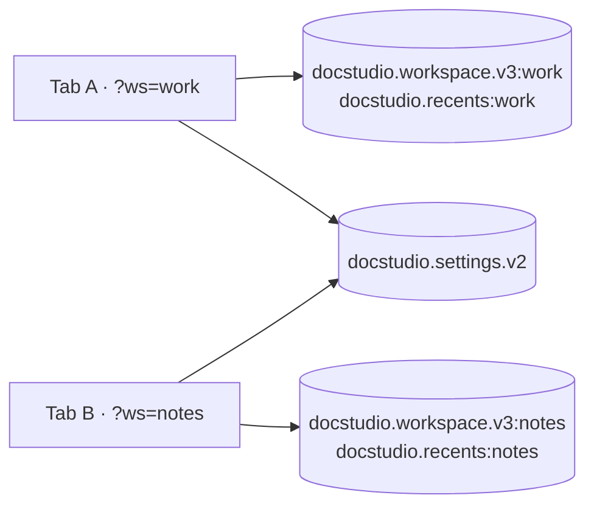

# Doc Studio — Storage schema

Everything Doc Studio persists lives on the client. This document is
the authoritative map of every key, its shape, its scope, and its
lifecycle.

**Index**

1. [Overview](#1-overview)
2. [Key namespace](#2-key-namespace)
3. [Workspace shape](#3-workspace-shape)
4. [Recents shape](#4-recents-shape)
5. [Settings shape](#5-settings-shape)
6. [LaTeX style config](#6-latex-style-config)
7. [Session storage](#7-session-storage)
8. [Migration policy](#8-migration-policy)
9. [Quota management](#9-quota-management)
10. [Multi-workspace isolation](#10-multi-workspace-isolation)
11. [Data inspection recipes](#11-data-inspection-recipes)
12. [Backup and restore](#12-backup-and-restore)
13. [Erasure](#13-erasure)

---

## 1. Overview

| Store | Backing | Scope | Encryption | Owner |
|-------|---------|-------|-----------|-------|
| Workspace | IndexedDB via localForage | Per `?ws=<id>` | None (client-only) | [`storage.ts`](../src/lib/storage.ts) |
| Recents | IndexedDB via localForage | Per `?ws=<id>` | None | `storage.ts` |
| Settings | IndexedDB via localForage | Global (all workspaces) | None | `storage.ts` |
| LaTeX style config | `localStorage` | Global | None | [`latexStyleConfig.ts`](../src/lib/latex/latexStyleConfig.ts) |
| Workspace-id memo | `sessionStorage` | Per tab | None | `storage.ts` |

Rationale for **client-only, no encryption**: the app is single-tenant
per install (see [HLD §14 non-goals](HLD.md#14-boundaries-and-non-goals)).
If you host it publicly or plan to sync, add a
user-supplied-key encryption layer client-side before write.

---

## 2. Key namespace

Every key is a string. `<ws>` is the resolved workspace id (see
[HLD §10.3](HLD.md#103-workspace-id-resolution)).

| Key | Store | Scope |
|-----|-------|-------|
| `docstudio.workspace.v3:<ws>` | IndexedDB | Per workspace |
| `docstudio.recents:<ws>` | IndexedDB | Per workspace |
| `docstudio.settings.v2` | IndexedDB | Global |
| `docstudio.latexStyle.v1` | localStorage | Global |
| `ws-session-id` (`WS_SESSION_KEY`) | sessionStorage | Per tab |

**Versioning.** `v3` on workspace = the third breaking shape change;
migrations happen at hydrate. `v2` on settings = same story. Never
mutate old-version keys in place — new versions become new keys and
the store treats missing new-version keys as "hydrate from old".

---

## 3. Workspace shape

Full TypeScript in [`src/lib/storage.ts`](../src/lib/storage.ts) as
`StoredWorkspace`.

```jsonc
{
  "files": [
    {
      "id": "doc-1727894215123-x7q",
      "title": "notes.md",
      "content": "# Hello",
      "language": "markdown",
      "original": "# Hello",              // last-saved baseline
      "archiveId": null,                  // linked collection/archive
      "archivePath": null,
      "createdAt": 1727894215123,
      "updatedAt": 1727894215999
    }
  ],
  "activeId": "doc-1727894215123-x7q",
  "archives": [
    {
      "id": "col-unsaved",
      "name": "Unsaved",
      "kind": "zip",
      "entries": [
        {
          "path": "draft.md",
          "size": 128,
          "language": "markdown",
          "content": "# Draft"
        }
      ],
      "primaryPath": null
    },
    {
      "id": "arch-1727894300000-abc",
      "name": "report.docx",
      "kind": "docx",
      "entries": [
        { "path": "(rendered preview).md", "size": 4210,
          "language": "markdown", "content": "...", "isRendered": true },
        { "path": "word/document.xml", "size": 12000,
          "language": "xml", "content": "..." },
        { "path": "word/media/image1.png", "size": 240000,
          "isBinary": true, "isImage": true,
          "binaryBase64": "iVBORw0KG…", "mimeType": "image/png" }
      ],
      "primaryPath": "(rendered preview).md"
    }
  ]
}
```

**Size rules for archive entries**

| Content kind | Storage |
|--------------|---------|
| Text ≤ `MAX_TEXT_PRELOAD_BYTES` (1 MB) | `content` filled |
| Text > 1 MB | `content` empty; loaded on demand from the source archive when the user clicks |
| Image ≤ `MAX_INLINE_IMAGE_BYTES` (3 MB) | `binaryBase64` + `mimeType` filled |
| Image > 3 MB | Kept as download-only; base64 not persisted |
| Other binary | Same as images (subject to the same cap) |

---

## 4. Recents shape

Array of at most `MAX_RECENTS = 12` items, most-recent first:

```jsonc
[
  { "id": "doc-1727894215123-x7q", "title": "notes.md",
    "language": "markdown", "excerpt": "# Hello",
    "updatedAt": 1727894215999 }
]
```

**Semantics**

- Pushing an id that's already present removes the old entry and
  re-adds at head (LRU).
- `excerpt` is the first ~180 chars — used purely for the sidebar
  preview.
- Recents are per-workspace, not global.

---

## 5. Settings shape

```jsonc
{
  "theme": "system",              // 'light' | 'dark' | 'system'
  "viewMode": "split",            // 'split' | 'editor' | 'preview'
  "previewMode": "html",          // 'html' | 'pdf'
  "mermaidTheme": "default",      // 'default' | 'dark'
  "zen": false,
  "tocOpen": true
}
```

Settings are **not** per-workspace. Theme and layout preferences carry
across every workspace on the same origin.

---

## 6. LaTeX style config

Stored under `localStorage['docstudio.latexStyle.v1']`. Full shape in
[latexStyleConfig.ts](../src/lib/latex/latexStyleConfig.ts):

```jsonc
{
  "fontSizePx": 12,
  "lineHeight": 1.25,
  "pagePaddingIn": 0.75,
  "h2MarginTopEx": 2.5,
  "h2MarginBottomEx": 1.0,
  "h2FontSizeEm": 1.15,
  "hugeFontSizeEm": 1.75,
  "listIndentEm": 1.5,
  "listItemSpacingRem": 0.15,
  "paragraphSpacingRem": 0.75
}
```

Reason for `localStorage`: config is small (~200 B), synchronous
reads are cheap, and the panel is fully client-side. IndexedDB's
async model would introduce a one-frame flash of default styles on
mount.

---

## 7. Session storage

`sessionStorage[WS_SESSION_KEY]` holds the resolved workspace id for
the tab. Its role:

1. Bridges the case where the URL `?ws=<id>` is stripped (e.g. some
   PWA start URL configurations).
2. Ensures every module load within the tab sees the same id — the
   `WORKSPACE_ID` module const is resolved exactly once at load; if
   the URL changes mid-session, the new id doesn't take effect until
   full reload.

Session storage clears when the tab closes, matching the "id is
tab-local" mental model.

---

## 8. Migration policy

- **Never mutate an existing schema version.** Add a new version
  suffix (`v4`, `v3`) and migrate at hydrate.
- **Migrations are idempotent.** Running twice must equal running
  once.
- **Only touched shapes are written back.** `migrateTexLanguage(ws)`
  returns the original object when nothing changed — avoiding an
  unnecessary IndexedDB round-trip.

Current migrations:

| Migration | Where | When it fires |
|-----------|-------|--------------|
| `.tex` language repair | [`useAppStore.migrateTexLanguage`](../src/store/useAppStore.ts) | On hydrate when any file or archive entry has a `.tex/.latex` path but `language: 'xml'` |

Planned migrations (see [ROADMAP](#roadmap-links)):

- `settings` v2→v3 for new mermaid theme fields.
- Workspace v3→v4 to add `pinned: boolean` on documents.

---

## 9. Quota management

Doc Studio does not currently enforce a client-side cap; it relies on
the browser's default IndexedDB quota (~60% of free disk on Chromium,
~1 GB on Safari, larger on Firefox).

**Recommended future work** (see [TDD §10 roadmap](TDD.md#10-roadmap)):

- Use `navigator.storage.estimate()` at hydrate and on autosave.
- Toast at 90% consumption suggesting cleanup.
- Offer a "clear old recents" and "shrink archive binaries" action.

**User-side mitigations**

- Delete an archive from the sidebar (`closeArchive` action).
- `Recents → Clear recents`.
- Open Chrome DevTools → Application → Clear storage → per-key
  deletion.

---

## 10. Multi-workspace isolation

Because keys are namespaced with `WORKSPACE_ID`, two windows opened
on different `?ws=<id>` values never share workspace or recents state.



**Non-goal.** Cross-tab sync of workspace changes is not implemented.
Two tabs on the same `?ws=<id>` will diverge and last-writer-wins on
next autosave. See [TDD §10 roadmap](TDD.md#10-roadmap) — planned
BroadcastChannel fix.

---

## 11. Data inspection recipes

### 11.1 Read a workspace from DevTools

```js
// In DevTools console (any Chromium):
const req = indexedDB.open('localforage');
req.onsuccess = () => {
  const tx = req.result.transaction('keyvaluepairs', 'readonly');
  tx.objectStore('keyvaluepairs').get('docstudio.workspace.v3:main')
    .onsuccess = (e) => console.log(e.target.result);
};
```

Or use localForage directly (already loaded by the app):

```js
localforage.getItem('docstudio.workspace.v3:main').then(console.log);
```

### 11.2 Export raw workspace JSON

```js
localforage.getItem('docstudio.workspace.v3:main').then(ws => {
  const blob = new Blob([JSON.stringify(ws, null, 2)], { type: 'application/json' });
  const a = document.createElement('a');
  a.href = URL.createObjectURL(blob);
  a.download = 'workspace-main.json';
  a.click();
});
```

### 11.3 Import raw workspace JSON

```js
// Assumes ws is a valid StoredWorkspace object.
localforage.setItem('docstudio.workspace.v3:main', ws).then(() => location.reload());
```

Warnings:

- The app rejects malformed shapes silently (falls back to blank
  workspace); check the console for parse errors.
- Migrations run on next hydrate — imported data will be normalised.

---

## 12. Backup and restore

There is no first-party backup UI. Recommended approaches:

1. **Per-workspace JSON dump.** Use the DevTools recipe above.
2. **Full-origin dump.** Use Chrome's `chrome://settings/content/all →
   Doc Studio origin → cookies and site data → download` (Chrome 122+),
   or Firefox's `about:preferences#privacy` per-site export.
3. **Archive export.** Every collection can be exported via
   [`ArchiveExportDialog`](../src/components/Dialogs/ArchiveExportDialog.tsx)
   as a `.zip` — a natural backup unit for anything you care about
   long-term.

---

## 13. Erasure

To fully erase a Doc Studio install for a given origin:

- Chromium: DevTools → Application → Storage → "Clear site data".
- Firefox: `about:preferences#privacy` → Cookies and Site Data →
  Manage Data → per-site remove.
- Programmatic (client console):
  ```js
  await localforage.clear();
  sessionStorage.clear();
  localStorage.removeItem('docstudio.latexStyle.v1');
  ```
- Delete a single workspace: **Header → Workspaces → …** → delete
  (the current workspace can't be deleted from that UI; open another
  first).

---

## Roadmap links

- [TDD §10 roadmap items 2, 4](TDD.md#10-roadmap) — cross-tab sync
  and quota introspection.
- [TDD §10 roadmap item 9](TDD.md#10-roadmap) — opt-in cloud sync
  with end-to-end encryption; would formalise a bulk export format.
