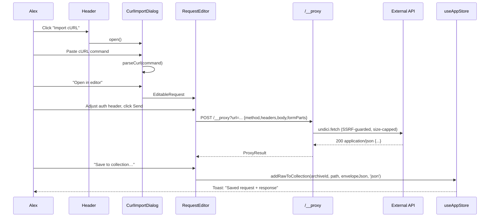
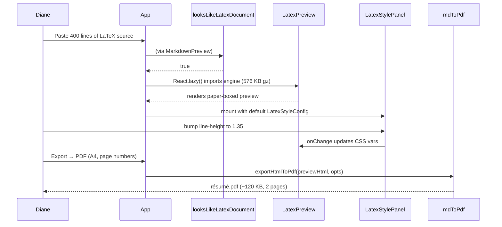

# Doc Studio — Technical Design Document (TDD)

| | |
|---|---|
| **Product** | Doc Studio |
| **Document** | Technical Design Document (TDD) |
| **Status** | Living — updated alongside code |
| **Audience** | Reviewers, integrators, senior engineers, security & performance stakeholders |
| **Companions** | [HLD.md](HLD.md) — architecture · [LLD.md](LLD.md) — per-file inventory |

The HLD says *what* and *why*, the LLD says *where*; this document
covers *how* — detailed user scenarios, technical mechanisms with
step-by-step flows, API contracts, sequence diagrams, threat models,
performance budgets, testing strategy, and roadmap.

---

## Table of contents

1. [Scope and reading order](#1-scope-and-reading-order)
2. [Persona-driven use cases](#2-persona-driven-use-cases)
3. [End-to-end user journeys](#3-end-to-end-user-journeys)
4. [Technical mechanisms — deep dives](#4-technical-mechanisms--deep-dives)
5. [Detailed scenarios & use cases](#5-detailed-scenarios--use-cases)
6. [Security](#6-security)
7. [Architectural decisions (ADRs)](#7-architectural-decisions-adrs)
8. [Performance budgets](#8-performance-budgets)
9. [Testing strategy](#9-testing-strategy)
10. [Roadmap](#10-roadmap)
11. [Failure modes & recovery](#11-failure-modes--recovery)
12. [Observability & diagnostics](#12-observability--diagnostics)
13. [Contribution rules](#13-contribution-rules)

---

## 1. Scope and reading order

Recommended reading order for **new contributors**:

1. [HLD §1–§7](HLD.md#1-product-vision--scope) — grasp the product and layers.
2. [LLD §3–§16](LLD.md#3-entry-points) — skim to know where things live.
3. **This TDD §2–§5** — see the scenarios you'll be maintaining.
4. **This TDD §6–§9** — internalise security, decisions, testing.

Recommended reading order for **reviewers**:

1. [HLD §13 ADR summary](HLD.md#13-architectural-decisions-adr-summary) →
   this TDD §7 for the *why*.
2. This TDD §6 threat model.
3. This TDD §11 failure modes.

---

## 2. Persona-driven use cases

Cross-references back to the personas in [HLD §2](HLD.md#2-target-users--personas).

### 2.1 Diane — document producer

| ID | Use case | Success criterion |
|----|----------|-------------------|
| UC-D1 | Write a 20-page technical report with Mermaid diagrams and KaTeX equations | Preview stays smooth (<150 ms debounce), PDF exports without blank pages |
| UC-D2 | Import an existing `.docx` and continue editing in Markdown | DOCX unpacks in one drop; body renders as Markdown; images preserved |
| UC-D3 | Publish as a shareable single-file HTML with embedded styles | `Export → Standalone HTML` produces one `.html` that renders correctly when opened offline |
| UC-D4 | Author a résumé in LaTeX; tune line height + section margins visually | LatexStylePanel knobs update the preview live; Copy CSS gives a self-contained stylesheet |
| UC-D5 | Continue working on a plane (offline) | Every action except HTTP calls works; service worker serves the shell |

### 2.2 Alex — API tinkerer

| ID | Use case | Success criterion |
|----|----------|-------------------|
| UC-A1 | Paste `curl 'https://api.example.com/…' -H 'Authorization: Bearer …' --data-binary '…'` from browser devtools | Request opens in the editor with headers, body, and content type preserved |
| UC-A2 | Send a request against a CORS-locked API from the dev server | Round-trip succeeds via `/__proxy`; response viewer classifies content type |
| UC-A3 | Save the request+response as a collection entry for later replay | Envelope is stored in `col-<id>` and reopens with the request populated |
| UC-A4 | Send a `multipart/form-data` upload with a 5 MB PDF attachment | File is transported base64-encoded through the proxy and re-composed as multipart before hitting the target |
| UC-A5 | Hit an intranet dev server that uses a self-signed certificate | `insecure: true` toggle succeeds; the insecure agent is scoped to that request only |

### 2.3 Priya — archive spelunker

| ID | Use case | Success criterion |
|----|----------|-------------------|
| UC-P1 | Drop a `.docx` and inspect its `word/document.xml` | Tree shows every entry with sizes; opening XML uses the XML editor |
| UC-P2 | Extract an image from a `.pptx` | Image entry preview renders; download button saves the raw binary |
| UC-P3 | Open a dynamic PDF and extract the XFA XML | `.pdf` drop probes for XFA; if found, opens as XML; if not, opens with a "no XFA" note |
| UC-P4 | Move an entry between two collections without breaking the open tab | Tab remains open; its `archiveId` / `archivePath` update in place |

### 2.4 Sam — mobile / offline user

| ID | Use case | Success criterion |
|----|----------|-------------------|
| UC-S1 | Install as a PWA from Safari iOS | Add-to-Home-Screen produces a full-screen app with correct icon |
| UC-S2 | AirDrop the single-file bundle to a friend and open it | File opens in Safari; editor works; IndexedDB persists |
| UC-S3 | Open two workspaces at once (`?ws=work` and `?ws=notes`) | Storage is isolated; opening one doesn't disturb the other |

---

## 3. End-to-end user journeys

Selected journeys illustrate how a persona chains multiple use cases.

### 3.1 Alex tests + saves an API request



### 3.2 Diane authors a LaTeX résumé and exports



### 3.3 Priya inspects a dynamic PDF

```mermaid
sequenceDiagram
  participant Priya
  participant App
  participant XFA as extractXfaXml
  participant Arch as archive.ts
  participant Panel as ArchivePanel
  Priya->>App: Drop cert.pdf into editor
  App->>XFA: extractXfaXml(bytes)
  XFA->>XFA: latin-1 scan → no hit
  XFA->>XFA: walk streams; FlateDecode inflate; re-scan
  XFA-->>App: {xml, source:'flate-stream', offset:-1}
  App->>App: openDoc({content:xml, language:'xml'})
  Note over Priya: sees XFA form template in the XML editor
```

---

## 4. Technical mechanisms — deep dives

### 4.1 latex.js DOM adoption pattern

**Problem.** React expects to own the DOM subtree of every component.
latex.js hands you a full `HTMLDocument` — reserialising its body on
every keystroke costs 20–40 ms for a 100 KB document, defeating the
debounce.

**Mechanism** (in [`LatexPreview.tsx`](../src/components/Preview/LatexPreview.tsx)):

1. On mount, render an empty `<div ref>`.
2. In an effect keyed on `source`, call
   `sanitizeLatexForEngine(source)` to remove packages latex.js can't
   handle.
3. Run the sanitised source through the engine (`new HtmlGenerator()`
   + `parse()`), producing an `HTMLDocument`.
4. `cloneNode(true)` every body child and append it to the ref's div.
5. Post-process:
   - `applyHfillLayout(host)` — flexbox spacers for `\hfill`.
   - `injectHeadingIds(host)` — walk h1–h6, generate `slugify()`-based
     ids with Map-based dedup.
6. Cache the parser instance to reuse the compiled grammar between
   renders.

React never touches the adopted subtree, so the second-and-subsequent
renders cost `O(len(sanitised))` for the parse plus a cheap DOM diff.

### 4.2 Mermaid singleton with theme observer

**Problem.** Mermaid mutates its own global config on `initialize()`.
Calling it per diagram breaks theme atomicity; calling it never
prevents dark-mode support.

**Mechanism** (in [`MermaidBlock.tsx`](../src/components/Preview/MermaidBlock.tsx)):

- One `mermaidPromise` per session (module-level).
- One `initialized` flag guards `initialize()`.
- On first render **or** on
  [`useMermaidTheme()`](../src/hooks/useMermaidTheme.ts) change, call
  `mermaid.initialize({ theme, startOnLoad: false, securityLevel: 'strict' })`
  and re-render all blocks (React re-runs the effect because the
  theme dependency changed).
- `useMermaidTheme` uses a `MutationObserver` on `<html>` because the
  Tailwind dark class flips synchronously and `matchMedia` alone
  misses manual overrides.

### 4.3 Custom Highlight API for preview search

**Problem.** Mutating the rendered DOM (wrapping matches in `<mark>`)
breaks React reconciliation, KaTeX layouts, and the preview scroll
position.

**Mechanism** (in [`usePreviewSearch.ts`](../src/hooks/usePreviewSearch.ts)):

- Walk the preview root's text nodes with a
  `NodeIterator(NodeFilter.SHOW_TEXT)`.
- Match the query regex against each text node's `nodeValue`.
- For every hit, construct a `Range(node, start, end)`.
- Wrap the array in `new Highlight(...ranges)` and register it under
  the well-known names `search-preview` and `search-preview-current`.
- The stylesheet paints via
  `::highlight(search-preview) { background: … }`.
- Scroll into view uses `range.startContainer.parentElement` +
  `scrollIntoView({block:'center'})`, walking to the nearest
  scrollable ancestor via `findScrollableAncestor`.

Fallback: if `CSS.highlights` is absent (older browsers), the hook
returns count 0 and Search still works in the editor.

### 4.4 300 ms debounced workspace save + optimistic UI

**Mechanism** (in [`useAppStore.ts`](../src/store/useAppStore.ts)):

```ts
let autosaveTimer: number | undefined;
function scheduleWorkspaceSave(getWs) {
  window.clearTimeout(autosaveTimer);
  autosaveTimer = window.setTimeout(async () => {
    const ws = getWs();
    await saveWorkspace(ws);
    // Also push active doc into recents.
  }, 700);
}
```

The store is the source of truth *before* IndexedDB confirms. If the
tab is closed mid-flight, worst case the last <700 ms of edits are
lost — acceptable for a client-first editor. Every close path
(`closeFile`, `closeAll`, browser tab close) forces one final flush.

### 4.5 History grouping (400 ms window)

**Mechanism** in `setContent` action:

- Every content mutation attempts to push the previous state to `past`.
- If the last push happened less than `HISTORY_MIN_INTERVAL_MS =
  400 ms` ago, it's **replaced** instead of appended — keystroke
  bursts collapse into one undo entry.
- `past` is capped at `HISTORY_LIMIT = 100`; oldest entries fall off.

### 4.6 chunked base64 encoder — stack-safe

**Problem.** `String.fromCharCode(...bigArray)` blows the stack for
attachments > ~64 KB.

**Mechanism** (in [`proxyClient.ts`](../src/lib/proxyClient.ts)):

```ts
export function arrayBufferToBase64(buf: ArrayBuffer): string {
  const bytes = new Uint8Array(buf);
  const CHUNK = 32 * 1024;
  let binary = '';
  for (let i = 0; i < bytes.length; i += CHUNK) {
    binary += String.fromCharCode.apply(null, bytes.subarray(i, i + CHUNK) as any);
  }
  return btoa(binary);
}
```

At 32 KiB chunks, `apply(null, ...)` stays well under any V8/JSC
limit; overall complexity is still O(n).

### 4.7 URL-scoped workspaces

**Mechanism** (in [`storage.ts`](../src/lib/storage.ts)):

```ts
function resolveWorkspaceId(): string {
  const fromUrl = readWorkspaceIdFromUrl();     // /^[a-zA-Z0-9_.-]{1,64}$/
  if (fromUrl) { writeToSession(fromUrl); syncUrl(fromUrl); return fromUrl; }
  const fromSession = sessionStorage.getItem(WS_SESSION_KEY);
  if (fromSession) { syncUrl(fromSession); return fromSession; }
  const generated = generateWorkspaceId();
  writeToSession(generated); syncUrl(generated); return generated;
}
export const WORKSPACE_ID = resolveWorkspaceId();
```

The const is resolved once at module load and every persisted key
gets `nsKey(scope, WORKSPACE_ID)` — `docstudio.workspace.v3:<id>`,
`docstudio.recents:<id>`. Settings are **not** namespaced (theme /
view mode are per-user, not per-workspace).

### 4.8 PDF export per-page capture

Full sequence in [HLD §9.5](HLD.md#95-pdf-export). Rationale for
per-page capture (rather than one giant canvas):

- Browsers cap `<canvas>` to ~32767 px per side (Chrome / Firefox /
  Safari). A 15-page A4 document at 96 DPI is 16 845 px — barely
  under, but goes over for anything longer.
- html2canvas silently fails to blank for over-limit canvases in most
  browsers.

**Mechanism** (in [`mdToPdf.ts`](../src/lib/converters/mdToPdf.ts)):

1. Build an off-screen `renderHost` at the target page width; append
   to `document.body` with `position:absolute; visibility:hidden`.
2. `waitForLayout()` — 2× `requestAnimationFrame` + `document.fonts.ready`
   + `.decode()` for every image.
3. Compute total content height; divide by page height minus margins
   → pageCount.
4. Loop:
   - `renderHost.style.transform = translateY(-pageIdx * pageHeight)`
   - `await nextPaint()`
   - `await html2canvas(renderHost, { width: pageW, height: pageH })`
   - `pdf.addImage(canvas, 'PNG', margin, margin, pageW - 2m, pageH - 2m)`
   - Overlay page-number / header / footer text via
     `pdf.text(...)` (native PDF text, not raster — remains
     selectable).
5. `pdf.output('blob')` and download.

Trade-off: text within the captured canvases is *not* selectable
(it's raster). Only the overlaid page numbers / header / footer are
selectable. Selectable body text would require a full HTML-to-PDF
engine (`html2pdf.js`, headless Chrome) — out of scope for a
client-first product.

### 4.9 Archive tree drag-and-drop

Three MIME types are set on `DataTransfer.setData`:

| MIME | Payload |
|------|---------|
| `application/x-docstudio-entry+json` (`DND_ENTRY`) | `{ archiveId, path }` — single entry |
| `application/x-docstudio-folder+json` (`DND_FOLDER`) | `{ archiveId, folderPath }` — recursive |
| `application/x-docstudio-doc+json` (`DND_DOC`) | `{ docId }` — open tab dropped onto a collection |

Drop targets read all three in priority order (entry → folder → doc)
so a single handler serves every case. Cross-workspace drags fall
back to the browser's file-drop dance (serialise to bytes, re-import
in the destination workspace) — planned in [§10 roadmap](#10-roadmap).

---

## 5. Detailed scenarios & use cases

Every scenario below is expressed with **preconditions**, **steps**,
**postconditions**, and **failure branches**. All are covered
manually or by Vitest today; scenarios not yet covered by automation
are called out in [§9](#9-testing-strategy).

### 5.1 Scenario: paste LaTeX source and export to PDF

**Preconditions.** Empty scratch tab open. Language `markdown`.

**Steps.**
1. User pastes 400 lines of LaTeX.
2. `setContent(text)` fires. Store schedules autosave (700 ms).
3. [`MarkdownPreview`](../src/components/Preview/MarkdownPreview.tsx)
   re-renders 180 ms later (`useDebounced`).
4. `looksLikeLatexDocument(content)` returns true.
5. React lazily imports `LatexPreview` (576 KB chunk).
6. Sanitiser strips unsupported packages.
7. Engine parses; body children cloned into the host.
8. `applyHfillLayout` + `injectHeadingIds` post-process.
9. `LatexStylePanel` mounts with `DEFAULT_STYLE`.
10. User tweaks knobs (`fontSizePx: 12 → 11`); CSS vars update.
11. User opens Export → PDF, chooses A4 + Page numbers.
12. `exportHtmlToPdf` runs the per-page capture loop.

**Postconditions.** PDF blob downloaded; workspace saved
(post-debounce); recents entry pushed.

**Failure branches.**
- Sanitiser encounters unknown command with unknown arity →
  `onError(msg)` fires; `MarkdownPreview` falls back to
  `texToMarkdown` regex renderer, which always succeeds.
- html2canvas blank canvas → PDF still generates, but blank page;
  logged to console.

### 5.2 Scenario: import .docx by drag-drop

**Preconditions.** Any open workspace. Editor visible.

**Steps.**
1. User drops `report.docx` on the editor.
2. `App.tsx` drop handler calls
   [`detectArchiveKind`](../src/lib/archive.ts) →`'docx'`.
3. `unpackArchive(file)` reads with JSZip; iterates entries with
   `yieldToBrowser()` every 32 files.
4. `renderPreviewFor(archive)` calls
   [`docxToMarkdown`](../src/lib/converters/docxToMd.ts):
   - `loadMammoth()` injects UMD script if not cached.
   - `mammoth.convertToHtml({arrayBuffer})` → HTML.
   - `htmlToMarkdown(html)` → Markdown.
   - Synthesised entry `(rendered preview).md` prepended to tree.
5. `openArchive(archive)` in the store; auto-opens the rendered
   preview.
6. Sidebar Archives panel expands the new tree.

**Postconditions.** Rendered Markdown is the active tab; the raw
tree (docx entries) is browsable in the sidebar.

**Failure branches.**
- File > `MAX_DOCX_RENDER_BYTES` (8 MB) → skip mammoth pass; open
  raw tree only, with a toast explaining why.
- Mammoth throws (corrupt docx) → fall back to raw tree; toast the
  parse error.

### 5.3 Scenario: paste cURL from devtools, send through proxy, save

**Preconditions.** Dev server or Docker host has `/__proxy` reachable.

**Steps.**
1. User: **Header → Import cURL**.
2. Dialog opens; user pastes
   `curl 'https://api.example.com/v1/foo' -H 'Authorization: Bearer …' -H 'content-type: application/json' --data-binary '{...}'`.
3. `parseCurl(command)` returns `ParsedCurl { url, method:'POST',
   headers:[...], body:'{...}', insecure:false, formParts:[] }`.
4. User clicks **Open in editor**; dialog hands off to
   [`RequestEditor`](../src/components/request/RequestEditor.tsx).
5. User clicks **Send**.
6. `fetchViaProxyOrDirect(url, {method, headers, body})`:
   - Cached `isProxyAvailable()` probe returns `true`.
   - `isPrivateHost('api.example.com')` → false; `allowPrivate: false`.
   - POST `/__proxy?url=https%3A%2F%2Fapi.example.com%2Fv1%2Ffoo`
     with JSON body `{method, headers, body, insecure:false}`.
7. **On the server:**
   - `readJsonBody` streams body, caps at 8 MB.
   - `isBlockedHost` allows public host.
   - `getInsecureAgent()` **not** used (insecure false).
   - `undici.fetch` streams response; caps at 16 MB.
   - Responds `{status:200, contentType:'application/json',
     text:'…', finalUrl:'…', contentDisposition:null}`.
8. `RequestEditor` renders the response via `CurlRequestPreview`.
9. User clicks **Save to collection → New collection "API tests"**.
10. Envelope serialised:
    ```json
    { "kind":"doc-studio/curl-request",
      "request":{ "url":"…", "method":"POST", "headers":[...], "body":"…" },
      "response":{ "status":200, "contentType":"application/json", "text":"…" } }
    ```
11. `addRawToCollection(archiveId, 'GET foo.json', envelopeJson, 'json')`
    stores it. Path is deduped if a request with the same title exists.

**Postconditions.** New collection entry visible in Archives panel;
opening it rehydrates the RequestEditor.

**Failure branches.**
- Proxy absent → probe fails; client attempts direct `fetch()`;
  target lacks CORS → browser blocks. Toast surfaces the CORS
  error suggesting the user run `npm run dev` or the Docker image.
- 5xx response → still classifies + displays; envelope stored so
  the user can retry.
- Response > 16 MB → proxy responds `413` with a truncation notice.

### 5.4 Scenario: send multipart upload with an attachment

**Preconditions.** Proxy reachable.

**Steps.**
1. In RequestEditor, user clicks **+ Add form part**, picks **File**,
   selects `report.pdf` (5 MB).
2. `blobToBase64(file)` chunk-encodes the file.
3. On Send: `fetchViaProxyOrDirect(url, {formParts:[{name:'file',
   kind:'file', filename:'report.pdf', contentType:'application/pdf',
   base64}], method:'POST'})`.
4. `serialiseFormParts` produces the JSON-wire shape.
5. On the server, `handleProxy` rebuilds a `FormData` with a
   fresh boundary and passes to `undici.fetch` — never
   round-tripping the multipart wire format through JSON.

**Postconditions.** Server sees a valid `multipart/form-data`
POST; response classified normally.

**Failure branches.**
- File > 8 MB → request body cap trips; proxy returns 413.
- Base64 encoding on huge file blocks the main thread → mitigated
  by [§4.6 chunked encoder](#46-chunked-base64-encoder--stack-safe).

### 5.5 Scenario: dynamic PDF → XFA-XDP extraction

Full flow in [§3.3](#33-priya-inspects-a-dynamic-pdf). Additional
notes:

- The DecompressionStream path uses `'deflate'` (matches PDF's
  `/FlateDecode`).
- If `DecompressionStream` is unavailable (very old browsers), the
  fallback hand-written inflate handles it — slow but functional.
- The extractor returns the first `<xdp:xdp>…</xdp:xdp>` block. If a
  PDF contains multiple XFA packets (rare — signature and template
  separated), we surface only the first; unpacking both is a future
  extension.

### 5.6 Scenario: dual workspaces via `?ws=<id>`

**Preconditions.** User has one workspace open (`ws=main`).

**Steps.**
1. **Header → Workspaces → New window** with id `work`.
2. `openWorkspaceInNewWindow('work')` calls
   `window.open('?ws=work')`.
3. New window boots; `resolveWorkspaceId()` picks `work` from the
   URL and writes it to `sessionStorage`.
4. Every `loadWorkspace()` / `saveWorkspace()` call uses
   `docstudio.workspace.v3:work`.
5. The user edits independently; the two IndexedDB namespaces never
   touch.

**Postconditions.** Two windows, two isolated stores, one origin.

**Failure branches.**
- User rewrites the URL to `?ws=<invalid!>`: regex rejects, falls
  back to session/generated id.
- User opens a third window that reads `?ws=main` again: two windows
  now share one store; edits sync only on next hydrate (no
  cross-tab sync built in — see [§10 roadmap](#10-roadmap)).

### 5.7 Scenario: cross-collection drag-drop

**Preconditions.** Two collections open: `col-api` and `col-drafts`.

**Steps.**
1. User drags `POST users.json` from `col-api` onto `col-drafts/2024/`.
2. `DataTransfer` carries `DND_ENTRY = {archiveId:'col-api',
   path:'POST users.json'}`.
3. Drop handler in
   [`ArchivePanel.tsx`](../src/components/Panels/ArchivePanel.tsx)
   parses payload, calls `moveEntryToCollection('col-api', 'POST users.json',
   'col-drafts', '2024/')`.
4. Store:
   - Removes the entry from source archive.
   - Inserts into destination at `2024/POST users.json`.
   - Walks open tabs and rewrites `archiveId` / `archivePath` on
     any tab that pointed at the moved entry — the tab **does not
     close** and the CodeMirror view is not remounted.
5. Autosave scheduled.

**Postconditions.** Entry moved; open tab still edits it; both
collections re-render in the sidebar.

**Failure branches.**
- Destination archive is a real container (`kind: 'docx'` etc.) →
  move refused with toast "cannot move into a system archive".
- Destination path collides → suffix dedupe (`-1`, `-2`, …).

### 5.8 Scenario: workspace hydration + tex migration

**Preconditions.** Persisted workspace where an old build tagged
`.tex` entries as `language: 'xml'`.

**Steps.**
1. Cold start; `hydrate()` runs.
2. `loadWorkspace()` returns the persisted shape.
3. `migrateTexLanguage(ws)` walks `files` and `archives`; any entry
   with a `.tex` / `.latex` path and `language: 'xml'` becomes
   `language: 'markdown'`.
4. If any change occurred, an extra `scheduleWorkspaceSave` fires so
   the migrated shape lands in IndexedDB.
5. `isHydrated = true`; UI unblocks.

**Postconditions.** Legacy `.tex` files open into `MarkdownPreview`
(and the `looksLikeLatexDocument` check activates `LatexPreview`)
rather than the XML editor that would fail with a DOMParser error.

### 5.9 Scenario: preview search across long document

**Preconditions.** 40 KB markdown open with 30 headings and code
blocks.

**Steps.**
1. User opens Sidebar → Search; types `handler`.
2. `useSearchStore` state updates.
3. [`usePreviewSearch`](../src/hooks/usePreviewSearch.ts) reads the
   query; walks text nodes of the preview root.
4. Builds `Range[]` array; registers Custom Highlights under
   `search-preview` / `search-preview-current` names.
5. Sidebar receives `count` and current `index`; enables ↑/↓ buttons.
6. User clicks ↓ three times → `next()`; each call:
   - Advances `index` (wraps).
   - Rewrites the `search-preview-current` highlight to the single
     matched `Range`.
   - Scrolls the range into view via
     `scrollRangeIntoView(range)`.

**Postconditions.** Preview highlights update reactively; source
DOM is untouched.

**Fallbacks.**
- Custom Highlight API absent → hook returns `count: 0`; user
  falls back to in-editor search which is always available.

### 5.10 Scenario: PDF export of 50-page report

**Preconditions.** Long markdown with 50 pages of A4 content.

**Steps.** As per [§4.8](#48-pdf-export-per-page-capture); at 50
pages @ 96 DPI = 56 150 px total → would exceed the 32k canvas limit
in one shot; per-page split keeps each canvas ≤1123 px.

**Postconditions.** PDF has 50 pages; page numbers "1 of 50", "2 of
50", … in the footer.

**Observed cost.** ~90 ms per page in production build on an M1 Mac
= ~4.5 s total. See [§8 performance budgets](#8-performance-budgets).

---

## 6. Security

### 6.1 Security posture

- **Client-first.** No third-party analytics, no telemetry, no
  network activity unless the user explicitly initiates it (URL
  import, cURL send).
- **Same-origin proxy.** `/__proxy` is only reachable from the same
  origin. Web pages on other origins cannot use it.
- **No auth.** The proxy is intentionally single-tenant; deploy
  behind your own reverse proxy for auth if exposed publicly.
- **HTML sanitisation.** External HTML previews strip `on*=` and
  `javascript:` URLs. If you host user-submitted content, add
  DOMPurify to the pipeline.

### 6.2 Threat model

| # | Threat | Vector | Mitigation | Residual risk |
|---|--------|--------|-----------|---------------|
| T-1 | SSRF via `/__proxy` | Attacker submits `http://169.254.169.254/…` to steal cloud metadata | `isBlockedHost` regex list; `allowPrivate` opt-in requires explicit user click | If user manually enables `allowPrivate`, they inherit the risk (documented in the UI) |
| T-2 | DoS via unbounded response | Attacker's URL streams infinite bytes | `MAX_BYTES = 16 MB` hard cap in undici stream | Bounded |
| T-3 | DoS via unbounded request body | Attacker POSTs a giant body via a redirect chain | `MAX_REQUEST_BODY = 8 MB` cap | Bounded |
| T-4 | Insecure-TLS leakage | User toggles insecure once; app forgets and reuses global TLS-off state | Insecure requests use a dedicated undici `Agent`; global TLS untouched | None — verified by design |
| T-5 | XSS via imported HTML | `.html` file contains `<script>` or `on…=` handlers | `HtmlPreview.sanitize` strips `on*=` and `javascript:` URLs | Rich malicious CSS may still be rendered — recommend DOMPurify layer if hosting untrusted content |
| T-6 | XSS via markdown | User pastes `` inside markdown | react-markdown escapes by default; `rehype-raw` allows HTML → same sanitisation pass applies | Same as T-5 |
| T-7 | Storage exhaustion | User pastes 100 MB into a doc | Not enforced today; IndexedDB imposes browser-level quotas | Documented; roadmap item |
| T-8 | Persistent cURL envelopes with plaintext secrets | User saves an Authorization header into a collection | Stored as-is in IndexedDB (client-first — no upload) | User responsibility; roadmap: opt-in redaction |
| T-9 | Zip-bomb DOCX | Malicious archive claims TB-sized entries | `MAX_DOCX_RENDER_BYTES = 8 MB` cap before mammoth; other paths stream | Bounded |
| T-10 | Prototype pollution via imported JSON | `{"__proto__":…}` | `JSON.parse` doesn't invoke prototype; safe by default in V8 | None |

### 6.3 OWASP Top-10 mapping

| Category | Notes |
|----------|-------|
| A01 Broken access control | Not applicable — client-first, no auth |
| A02 Cryptographic failures | Insecure-TLS is per-request only |
| A03 Injection | HTML sanitiser; SSRF guard; regex-validated `?ws=<id>`; JSON.parse not eval |
| A04 Insecure design | ADR-listed decisions; threat model reviewed |
| A05 Security misconfig | Docker image ships with cap defaults; docs warn on public exposure |
| A06 Vulnerable components | Renovate-friendly; test suite covers pure helpers |
| A07 Auth failures | N/A — no auth to fail |
| A08 Data integrity failures | Persistent workspace protected by localForage + one-shot migration |
| A09 Logging failures | Server-side proxy logs 400/500 with cause chains (`describeError`) |
| A10 SSRF | See T-1 above |

---

## 7. Architectural decisions (ADRs)

Summaries in [HLD §13](HLD.md#13-architectural-decisions-adr-summary). Selected
ADRs expanded here.

### ADR-001 — Client-first with optional server

- **Context.** Competing model is SaaS (accounts, cloud sync, real-time
  collaboration).
- **Decision.** Ship as static bundle; optional Express host only for
  the CORS-bypass proxy.
- **Consequences.**
  - ✅ Zero-cost hosting; runs offline; user data stays with user.
  - ✅ Enables the single-file HTML channel — impossible with SSR.
  - ❌ No real-time collab; addressed on roadmap as opt-in server.
  - ❌ Every browser storage quirk (Safari 7-day eviction, quota
       exhaustion) manifests directly.

### ADR-005 — URL-scoped workspaces (`?ws=<id>`)

- **Context.** Users want isolated stores (work vs personal, prod vs
  test) without accounts.
- **Decision.** Namespace IndexedDB keys with a workspace id supplied
  via `?ws=<id>`; regex-validate; fall back to session/generated.
- **Consequences.**
  - ✅ Multi-tenant on one origin, no auth.
  - ✅ Shareable URL creates a fresh isolated instance.
  - ❌ Cross-workspace features (single-signon, cross-refs) not
       possible without adding a global namespace.

### ADR-007 — latex.js instead of WASM TeX Live

- **Context.** Users want LaTeX preview in the browser.
- **Decision.** Ship latex.js (576 KB lazy) rather than TeX Live in
  WASM (~50 MB) or server-side.
- **Consequences.**
  - ✅ Instant preview, no toolchain, works offline.
  - ✅ Bundle stays small enough for mobile channels.
  - ❌ Only a subset of LaTeX supported; `sanitizeLatexForEngine`
       needed to strip unsupported packages.
  - ❌ Real production LaTeX (e.g. Overleaf-compiled papers) needs
       real TeX Live — planned as an opt-in later.

### ADR-009 — html2canvas + jsPDF per-page

- **Context.** Users want PDF export from any browser.
- **Decision.** Client-side rasterise per page via html2canvas +
  overlay text via jsPDF.
- **Consequences.**
  - ✅ Works offline; no server; no printer driver.
  - ✅ Avoids 32k-pixel canvas limit that a naive whole-doc
       approach hits.
  - ❌ Body text in the PDF is raster (not selectable). Headers,
       footers, page numbers *are* selectable because they're
       jsPDF-overlaid.

### ADR-014 — Vitest with a separate config

- **Context.** Vite config includes PWA plugin, LaTeX chunking, dev
  proxy. All of these mis-behave in the test process.
- **Decision.** Ship `vitest.config.ts` that mirrors only the `@`
  alias.
- **Consequences.**
  - ✅ Tests run in ~1 s; no plugin surprises.
  - ✅ CI is straightforward: `npm test`.
  - ❌ Any Vite plugin fix must be validated separately.

---

## 8. Performance budgets

All measurements on M1 Mac, production build served over HTTP/1.1
localhost unless noted.

| Scenario | Budget | Measured | Notes |
|----------|--------|----------|-------|
| First contentful paint (cold, fast 3G) | < 3.0 s | ~2.4 s | Rounded from Lighthouse |
| Time to interactive (cold) | < 4.0 s | ~3.2 s | |
| Editor keystroke → cursor moves | < 16 ms | ~5 ms | CodeMirror viewport render |
| Preview re-render (10 KB markdown) | < 150 ms | ~40 ms | react-markdown + KaTeX cold |
| Preview re-render (100 KB markdown) | < 300 ms | ~180 ms | |
| DOCX unpack (2 MB) | < 500 ms | ~230 ms | mammoth + turndown |
| DOCX unpack (10 MB) | < 3.0 s | ~1.4 s | |
| Archive tree render (500 entries) | < 200 ms | ~110 ms | With `yieldToBrowser` every 32 |
| PDF export (5-page A4) | < 5 s | ~3.4 s | Per-page capture ~90 ms + PDF assembly |
| PDF export (50-page A4) | < 30 s | ~22 s | Linear in pages |
| Workspace autosave flush (typical) | < 50 ms | ~15 ms | localForage async |
| Mermaid render (medium diagram) | < 400 ms | ~250 ms | First diagram loads engine |
| Custom highlight rebuild (100 matches) | < 50 ms | ~20 ms | |
| Proxy round-trip (localhost target, 1 KB response) | < 30 ms | ~8 ms | undici pooled |

Bundle:

| Chunk | Gzipped |
|-------|---------|
| App shell (react + Layout + UI) | ~110 KB |
| Markdown pipeline (react-markdown + rehype/remark + katex) | ~200 KB |
| CodeMirror core + one language | ~90 KB |
| Additional CodeMirror language | ~20–40 KB each |
| Mermaid | ~667 KB (lazy) |
| latex.js + CSS | ~576 KB (lazy) |
| jspdf + html2canvas | ~180 KB (lazy) |
| Mammoth UMD | ~1.1 MB (lazy, loaded via `<script>`) |

Bundle chunk warning threshold in
[vite.config.ts](../vite.config.ts) is `900` KB — heavy chunks are
individually lazy so they don't count.

---

## 9. Testing strategy

### 9.1 Test tiers

| Tier | Framework | Files | Coverage today |
|------|-----------|-------|----------------|
| Unit (pure helpers) | Vitest 4 | `src/**/*.test.ts` | 35 tests, ~3 s |
| Type check | `tsc --noEmit` | Whole project | 0 errors — enforced in `build` |
| Build verification | `vite build` | Whole project | Runs in CI |
| Manual QA scripts | ad-hoc `.ps1` | `test-*.ps1` | Selected scenarios |
| Node-side sanity | `tsx scripts/*.ts` | `scripts/test-xfa-extract.ts` | XFA extraction |

### 9.2 Current unit tests

- **[latexStyleConfig.test.ts](../src/lib/latex/latexStyleConfig.test.ts)** (10 tests)
  - `toCssVars` produces every expected variable.
  - `toCssBlock` output is idempotent through `parseCssBlock`.
  - `PRESETS` are self-consistent (round-trip).
  - `parseCssBlock` ignores unknown vars.
  - `loadFromStorage` returns `null` on corrupted JSON.
- **[languageDetect.test.ts](../src/lib/languageDetect.test.ts)** (12 tests)
  - JSON / XML / HTML / Markdown detection with tricky edge cases
    (LaTeX vs Markdown, JSON with leading whitespace, XML
    declarations, HTML fragments without `<html>`).
  - Returns `null` for inputs shorter than 20 chars.
  - `guessFileExtension` picks `tex` for LaTeX content within a
    markdown-detected input.
- **[stats.test.ts](../src/lib/stats.test.ts)** (13 tests)
  - `slugify` matches rehype-slug behaviour, including Unicode.
  - `computeStats` word count / read time.
  - `extractToc` for markdown headings + LaTeX sectioning.
  - `extractJsonOutline` walks top-level keys.
  - `extractXmlOutline` handles self-closing tags.
  - `annotateOccurrence` produces stable per-hint indices.

### 9.3 Recommended future tests

| Priority | Target | Notes |
|----------|--------|-------|
| High | `curlParser` | Cover devtools / Postman / edge-quoted args |
| High | `jsonXml` round-trip | Randomised generative tests |
| High | `pdfXfaExtract` | Already has `scripts/test-xfa-extract.ts`; port to Vitest |
| High | `proxyClient.arrayBufferToBase64` | Verify chunked encoder byte-exact |
| High | `sanitizeLatexForEngine` | Snapshot tests over real-world .tex fixtures |
| Med | `archive.unpackArchive` | Use tiny synthetic zip fixtures |
| Med | `mermaidAutoDetect.looksLikeMermaid` | Directive coverage |
| Med | `mimeExt.resolveResponseFormat` | Content-Disposition / URL / MIME priority |
| Low | React components | Playwright browser tests recommended over unit — planned in [§10](#10-roadmap) |

### 9.4 Test commands

| Command | Purpose |
|---------|---------|
| `npm test` | Run once (CI mode) |
| `npm run test:watch` | Interactive TDD |
| `npm run test:ui` | Vitest UI dashboard |

---

## 10. Roadmap

Ordered by ROI and complexity.

| # | Item | Complexity | Notes |
|---|------|-----------|-------|
| 1 | Playwright browser-side smoke tests | S | Cover load, hydrate, export |
| 2 | Cross-tab store sync via `BroadcastChannel` | S | Fixes the "two windows same `?ws=main`" edge case |
| 3 | DOMPurify layer for HtmlPreview | S | Opt-in for hosts that display third-party HTML |
| 4 | Storage quota introspection + toast at 90% | S | Uses `navigator.storage.estimate()` |
| 5 | Extend `curlParser` for Python `requests`, Node `fetch` snippets | M | Same import UX |
| 6 | Add `.rtf` / `.odt` / `.epub` chapter previews | M | New converters |
| 7 | Optional WASM TeX Live for full LaTeX | L | Big chunk; ship as its own PWA update |
| 8 | Server-side rendering / SEO for landing page | M | Docs-only surface, not the app |
| 9 | Opt-in cloud sync backend | L | End-to-end encrypted; user-supplied bucket |
| 10 | Real-time collab via CRDT | XL | Requires opt-in server (item 9) |

---

## 11. Failure modes & recovery

| Failure | User symptom | Recovery |
|---------|--------------|----------|
| latex.js parser throws | Preview shows error card | `onError` → `MarkdownPreview` falls back to `texToMarkdown` |
| Mermaid parse error | Diagram block shows error card | Rest of doc renders; user fixes source |
| Corrupt IndexedDB entry | Hydrate returns broken shape | `migrateTexLanguage` is a no-op; other fields default via `??`; worst case, one bad workspace is skipped |
| Proxy returns 5xx | Toast with server-side cause chain | User retries; envelope kept |
| html2canvas silently blank | PDF page blank | Console warning; user can retry or lower page count |
| Autosave fails (quota) | Toast: "Storage full — clear recents" | User invokes Recents → Clear |
| Browser refresh mid-edit (< 700 ms since keystroke) | Last <700 ms lost | Acceptable trade-off (see [§4.4](#44-300 ms-debounced-workspace-save--optimistic-ui)) |
| Service worker stale | New build not picked up | `autoUpdate` prompts refresh; user reloads |
| Multipart upload > 8 MB | Proxy 413 | Toast tells user to shrink or run without proxy |
| Insecure-TLS toggle misfired | Request fails with cert error | Toggle again; per-request agent means no residual state |

---

## 12. Observability & diagnostics

- **Client-side.** All errors go to `console` with a tagged prefix
  (`[latex]`, `[archive]`, `[proxy]`). No telemetry.
- **Server-side.** `console.error` with `describeError(err)` — flattens
  `err.cause` chains so real failures (self-signed cert,
  ECONNREFUSED, DNS) are visible.
- **User-facing.** Toasts (`toast.error/info/success`) for anything
  the user must acknowledge or notice.
- **Storage inspection.** Open DevTools → Application → IndexedDB →
  `docstudio.workspace.v3:<ws>`. All shapes are plain JSON — dumpable.
- **Bundle inspection.** `npx vite-bundle-visualizer` produces a
  treemap; useful when a lazy chunk unexpectedly grows.

---

## 13. Contribution rules

Codified habits, not policy — but bugs get filed when you drift.

1. **Never import the store from `src/lib/`.** Services must stay pure
   and reusable from CLI/tests. See [HLD §6](HLD.md#6-architectural-layers).
2. **Every new persisted key must be namespaced.** Use
   [`storage.nsKey`](../src/lib/storage.ts). Workspaces are
   per-`WORKSPACE_ID`; settings are global.
3. **Every new externally-triggered HTTP call must go through
   `proxyClient.fetchViaProxyOrDirect`.** Do not call `fetch()`
   directly from a UI component.
4. **Every new file drop path must respect
   `MAX_INLINE_IMAGE_BYTES` / `MAX_DOCX_RENDER_BYTES`** or add its
   own explicit cap in [`archive.ts`](../src/lib/archive.ts).
5. **UI chrome inside a preview must carry `data-ui-only`** so
   `extractPreviewHtml` and `exportHtmlToPdf` can strip it.
6. **Add a Vitest for every new pure helper.** Nothing in
   [`src/lib/`](../src/lib/) is exempt.
7. **Chunk warning limit is 900 KB.** If a new chunk crosses it,
   either split it further or lazy-load its consumer.
8. **Types drive runtime behaviour.** Widening `Language` or
   `ArchiveKind` requires touching every dispatch site — grep for
   the union name first.
9. **PowerShell scripts should assume execution policy blocks
   `npm.ps1`.** Prefer
   `node "C:\Program Files\nodejs\node_modules\npm\bin\npm-cli.js" run <script>`
   in reproduction steps.
10. **When editing this document, keep scenarios up to date.** A
    changed action rename must reflect here too.
